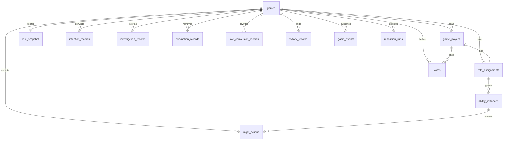

# Data Model

PostgreSQL is the system of record. The domain package uses plain objects. The API adapter maps those objects with Drizzle. Redis is not required for correctness. A single API node can hold sockets in memory. A later multi-node deployment can add a Socket.IO Redis adapter without moving game state out of PostgreSQL.

The catalog of role definitions lives in code. Each game stores the catalog hash and a frozen configuration snapshot so a future catalog edit does not rewrite an active game.

---

## 1. Ownership

`games` is the aggregate root. Every other gameplay row carries `game_id` and is deleted only when a finished game is archived by an explicit retention job. Child rows are not edited in ways that hide history.

| Entity | Owned by | Mutability |
|---|---|---|
| Game | Room | Phase and version change. Snapshot does not |
| Game player | Game | Life status and connection change |
| Role assignment | Player in a game | Current role and faction change. Originals do not |
| Ability instance | Assignment | Charges and status change |
| Round / phase history | Game | Append only |
| Night action | Round and ability | Pending row may be replaced until lock, then status only moves forward |
| Vote | Ballot | New row supersedes the old one |
| Infection, elimination, investigation, conversion | Game | Append only |
| Game event | Game | Append only |
| Resolution run | Round | One row, insert only |
| Victory record | Game | Insert, or status update from pending to revoked |

---

## 2. Identity and concurrency

- Primary keys are UUIDs, except `game_events.seq`, which is a per-game increasing integer.
- `games.state_version` increments on every committed transition.
- Transitions use `UPDATE ... WHERE id = $id AND state_version = $expected`.
- Night and day resolution also `SELECT ... FOR UPDATE` on the game row.
- `resolution_runs` has a unique `(game_id, round_number, phase_kind)`.
- Night actions have a unique `(game_id, round_number, ability_instance_id)` while status is pending or locked.
- Clients send `Idempotency-Key`. The unique `(game_id, idempotency_key)` returns the stored response.

---

## 3. Tables

### games

| Column | Type | Notes |
|---|---|---|
| id | uuid pk | |
| room_code | text | 6 characters from an unambiguous alphabet |
| status | text | `LOBBY`, `ACTIVE`, `FINISHED`, `CANCELLED` |
| phase | text | See phase list below |
| round_number | int | Starts at 1 when the game starts |
| state_version | int | Starts at 0 |
| host_player_id | uuid | |
| mode | text | |
| config_snapshot | jsonb | Frozen at start. Lobby draft lives in `config_draft` |
| config_draft | jsonb | Editable only in lobby |
| catalog_hash | text | |
| phase_started_at | timestamptz | |
| phase_ends_at | timestamptz null | Null when host-paced |
| winner_summary | jsonb null | Filled at end |
| created_at / updated_at | timestamptz | |

Indexes:

- Unique `room_code` where status in (`LOBBY`, `ACTIVE`).
- Index `(status, phase)` for recovery scans.
- Index `phase_ends_at` where status is `ACTIVE` and a deadline is set, for the phase timer and boot recovery (migration `0004_phase_machine`).

Checks added in `0004_phase_machine` (WW-501):

- Status and phase agree. `LOBBY`, `FINISHED`, and `CANCELLED` each pair with the phase of the same name. Every other phase is `ACTIVE`.
- `round_number` is 0 in the lobby and at least 1 while active.
- Only an active game has `phase_ends_at`.

Phases: `LOBBY`, `ROLE_REVEAL`, `NIGHT_SUBMIT`, `NIGHT_HOST_CONFIRM`, `NIGHT_REACTION`, `DAY_ANNOUNCE`, `DAY_DISCUSSION`, `VOTING`, `REVOTE`, `FINISHED`, `CANCELLED`.

Resolution itself is a transaction inside the closing of `NIGHT_REACTION` or `NIGHT_SUBMIT`, and inside the closing of `VOTING` or `REVOTE`. It is not a phase clients linger in.

### game_players

| Column | Type | Notes |
|---|---|---|
| id | uuid pk | |
| game_id | uuid fk | |
| display_name | text | Unique per game |
| seat_number | int | Unique per game |
| avatar_id | int | 1 to 36, unique per game. Chosen in the lobby or assigned as the lowest free one (WW-305) |
| is_host | boolean | |
| life_status | text | `ALIVE`, `DEAD` |
| connection_status | text | `CONNECTED`, `DISCONNECTED` |
| token_hash | text | SHA-256 of the bearer token. The raw token is shown once |
| died_round | int null | |
| created_at | timestamptz | |

### role_assignments

Written in the start transaction (WW-402, migration `0003_assignments`). The `original_*` columns, `game_id`, and `player_id` never change. Two things enforce that: the repository (`apps/api/src/assignment/assignment.repository.ts`) has no update that names them, and the trigger `role_assignments_keep_original_trg` rejects such an UPDATE with SQLSTATE `23001`.

| Column | Type | Notes |
|---|---|---|
| id | uuid pk | |
| game_id | uuid | |
| player_id | uuid unique | One assignment per player |
| original_role_id | text | Immutable |
| original_profile_id | text | Immutable. The dealt ability profile, such as `doctor_infection`. Single-profile roles use the role id |
| current_role_id | text | |
| current_profile_id | text | Changes with the current role |
| original_faction | text | Immutable |
| current_faction | text | |
| wolf_aligned | boolean | |
| individual_victory | text | `NONE`, `ACHIEVED`, `FAILED`, `REVOKED` |
| public_reveal | boolean | |
| mark_target_player_id | uuid null | Assassin mark |

### ability_instances

| Column | Type | Notes |
|---|---|---|
| id | uuid pk | |
| game_id | uuid | |
| player_id | uuid | |
| assignment_id | uuid | |
| ability_id | text | |
| capability | text null | Null when a handler carries the whole mechanic, such as the Assassin's mark |
| handler_key | text null | |
| status | text | `ACTIVE`, `REVOKED`, `EXHAUSTED`, `SCHEDULED` |
| charges_remaining | int null | Null means unlimited |
| uses_consumed | int | |
| last_used_round | int null | |
| last_target_player_id | uuid null | Supports Guard's consecutive rule |
| available_from_round | int | |
| expires_round | int null | Shapeshifter copies |
| source | text | `NATIVE`, `COPY`, `INHERITED` |
| source_player_id | uuid null | |
| config | jsonb | The ability definition with this game's overrides applied, frozen at grant time |
| revoked_reason | text null | |

Unique `(assignment_id, ability_id)` where `source = 'NATIVE'`. Copies and inherited abilities may repeat an ability id.

### night_actions

| Column | Type | Notes |
|---|---|---|
| id | uuid pk | |
| game_id | uuid | |
| round_number | int | |
| player_id | uuid | |
| ability_instance_id | uuid | |
| target_player_ids | uuid[] | |
| payload | jsonb | |
| status | text | `PENDING`, `LOCKED`, `RESOLVED`, `REJECTED`, `CANCELLED` |
| idempotency_key | text | |
| submitted_at | timestamptz | |

Unique `(game_id, idempotency_key)`.

Unique `(game_id, round_number, ability_instance_id)`.

### votes

| Column | Type | Notes |
|---|---|---|
| id | uuid pk | |
| game_id | uuid | |
| round_number | int | |
| ballot | int | 1 for the first vote, 2 for the revote |
| voter_player_id | uuid | |
| target_player_id | uuid null | Null abstains |
| weight | int | Copied from the modifier state at close, not at submit, so a modifier expiring mid-ballot is deterministic. Recommended: compute weight at close |
| superseded | boolean | |
| submitted_at | timestamptz | |

Index `(game_id, round_number, ballot, voter_player_id, superseded)`.

### infection_records

| Column | Type |
|---|---|
| id | uuid |
| game_id | uuid |
| round_number | int |
| source_player_id | uuid |
| target_player_id | uuid |
| previous_role_id | text |
| outcome | text |
| failure_reason | text null |
| created_at | timestamptz |

### investigation_records

| Column | Type |
|---|---|
| id | uuid |
| game_id | uuid |
| round_number | int |
| actor_player_id | uuid |
| ability_id | text |
| target_player_ids | uuid[] |
| result | jsonb |
| published | boolean |

`result` is the private fact. Publication copies it into a public event. The private row stays.

### elimination_records

| Column | Type |
|---|---|
| id | uuid |
| game_id | uuid |
| round_number | int |
| phase_kind | text | `NIGHT` or `DAY` |
| player_id | uuid |
| role_at_death | text |
| original_role_id | text |
| faction_at_death | text |
| causes | jsonb | Ordered cause objects |
| revealed_publicly | boolean |

### role_conversion_records

| Column | Type |
|---|---|
| id | uuid |
| game_id | uuid |
| round_number | int |
| player_id | uuid |
| from_role_id | text |
| to_role_id | text |
| from_faction | text |
| to_faction | text |
| reason | text | `INFECTION`, `CURSED`, `INHERIT`, `COPY_GRANT`, `COPY_EXPIRE` |

### victory_records

| Column | Type |
|---|---|
| id | uuid |
| game_id | uuid |
| round_number | int |
| scope | text | `TEAM` or `INDIVIDUAL` |
| faction | text null |
| player_id | uuid null |
| role_id | text null |
| outcome | text | `WIN`, `DRAW` |
| terminal | boolean |

### game_events

| Column | Type |
|---|---|
| game_id | uuid |
| seq | bigint | Unique with game_id |
| type | text |
| audience | text | `PUBLIC`, `HOST`, `PLAYER` |
| recipient_player_id | uuid null |
| payload | jsonb |
| dedupe_key | text | As built in WW-804. Unique with game_id |
| created_at | timestamptz |

Primary key `(game_id, seq)`. Unique `(game_id, dedupe_key)`. Index `(game_id, audience, recipient_player_id, seq)`. A night publish also writes one `HOST` marker, type `NIGHT_PUBLISHED`, key `night:{round}:published`, so a second publish of that night is a no-op. `(audience = 'PLAYER')` is exactly when `recipient_player_id` is set.

Clients reconnect with `afterSeq` and receive only rows their token may see.

### chat_messages

Table chat (WW-1104, OD-72). Not `game_events`: chat is not a game fact, the host can delete a message, and the channel is emptied when the game ends.

| Column | Type |
|---|---|
| id | uuid |
| seq | bigint | Global identity. Orders messages within a game. Never reused after a deletion |
| game_id | uuid |
| player_id | uuid | The author |
| body | text | Trimmed. 1 to 280 code points |
| round_number | integer |
| phase | text | `DAY_DISCUSSION`, `VOTING`, `REVOTE` |
| created_at | timestamptz |

Unique `seq`. Index `(game_id, seq)`. There is no audience or recipient column: every message is public to the game's seats, so a wolf or dead channel cannot be stored.

### day_tallies

The public result of one closed ballot (WW-904, OD-85). Written in the day resolution from the tally that decided the ballot.

| Column | Type |
|---|---|
| game_id | uuid |
| round_number | integer |
| ballot | integer | 1 or 2 |
| counts | jsonb | `[{ targetPlayerId, total }]`, weighted, highest first |
| abstentions | integer |
| voted_out_player_id | uuid null | Null for a tie or no votes |
| tied_player_ids | uuid[] |
| created_at | timestamptz |

Primary key `(game_id, round_number, ballot)`. No voter ids: those stay in `votes`, read only by the host.

### chat_mutes

| Column | Type |
|---|---|
| game_id | uuid |
| player_id | uuid | The muted seat |
| created_at | timestamptz |

Primary key `(game_id, player_id)`. A row means muted. Unmuting deletes it.

The trigger `chat_forget_on_end_trg` on `games` deletes a game's `chat_messages` and `chat_mutes` rows when `status` becomes `FINISHED` or `CANCELLED`. It sits on the column rather than in each code path that ends a game.

### resolution_runs

| Column | Type |
|---|---|
| id | uuid |
| game_id | uuid |
| round_number | int |
| phase_kind | text |
| input_hash | text |
| result | jsonb |
| created_at | timestamptz |

Unique `(game_id, round_number, phase_kind)`.

### scheduled_effects

Added in `0006_night_resolution` (WW-801, WW-802). Something one resolution leaves for a later one.

| Column | Type | Notes |
|---|---|---|
| id | uuid pk | |
| game_id | uuid | |
| kind | text | `SHIELD` (a Blacksmith item on its holder), `POISON` (a Poisoner's delayed poison), `REVENGE` (an Avenger's queued revenge) |
| source_player_id | uuid | |
| source_ability_instance_id | uuid | |
| target_player_id | uuid | The holder, the victim, or the revenge target |
| created_round | int | |
| due_round | int null | Null for a shield |
| due_phase | text null | `NIGHT` or `DAY`. Null exactly when `due_round` is |
| attack_types | text[] | The attack a POISON or REVENGE adds, or what a SHIELD cancels |
| status | text | `ACTIVE`, `SPENT` (landed or blocked), `EXPIRED` (holder or target died first) |
| closed_round | int null | Set exactly when the status leaves `ACTIVE` |

Partial index on `game_id` where status is `ACTIVE`. The night resolver reads the open rows; the day resolution (WW-901) applies a `POISON` due in the day.

### idempotency_keys

| Column | Type |
|---|---|
| game_id | uuid |
| key | text |
| request_hash | text |
| response | jsonb |
| created_at | timestamptz |

Unique `(game_id, key)`. The same key with a different request hash returns 409.

As built in `0005_night_actions` (WW-601): the key is unique per `(game_id, player_id, key)`, so one seat can never replay or block another seat's request. `night_actions` also has `phase` (`NIGHT_SUBMIT`, `NIGHT_REACTION`, or `DAY_DISCUSSION`) and `updated_at`. The open-action index is unique on `(game_id, round_number, ability_instance_id)` where status is `PENDING` or `LOCKED`. A replaced choice is set to `CANCELLED` and a new row inserted, so every choice stays on record. Closing a window sets its `PENDING` rows to `LOCKED` in the same transaction.

As built in `0006_night_resolution` (WW-802):

- `games` has `infection_successes` (successful Alpha infections, C-04) and `infection_sealed` (the Alpha has died, C-09). Night resolution reads and writes both.
- `night_actions` has `rejected_reason`, set only with status `REJECTED`: `ABILITY_UNAVAILABLE`, `WRONG_PHASE`, `TARGET_ILLEGAL`, `BLOCKED`, or `NOT_IMPLEMENTED`.
- `elimination_records` is unique on `(game_id, player_id)`, because a player dies once. `causes` holds `{ type, via, actorIds }` objects in step order, with every contributor (OD-13). `via` is `PACK`, `ABILITY`, `EFFECT`, or `REDIRECT`.
- `infection_records` has `action_id`. `failure_reason` is null exactly when the outcome is `SUCCESS`.
- `investigation_records` has `action_id` (unique, one fact per action), `ability_instance_id`, and `kind` (the ability's result kind). `result` holds the fact without those columns, such as `{ "value": "WOLF" }`.
- `role_conversion_records` holds only role changes: `INFECTION` and `CURSED`. A copy or an inheritance hands over abilities, not a role; its record is the `ability_instances` row (`source` COPY or INHERITED, `source_player_id`). `INHERIT`, `COPY_GRANT`, and `COPY_EXPIRE` stay allowed for a later permanent-theft rule.
- `resolution_runs.result` is the resolver's whole result, for the host dashboard and audit.

---

## 4. Relationships

`role_snapshot` in the diagram is `games.config_snapshot` plus `catalog_hash`, not a second catalog table.

---

## 5. Recovery

On process start:

1. Load games with status `ACTIVE`.
2. For timed games with `phase_ends_at` in the past, enqueue the same transition the timer would have run. Implemented in WW-502: `PhaseService.recover` schedules every open deadline on boot, and past ones close straight away.
3. For host-paced games, leave the phase and wait.
4. Do not recompute a round that already has a `resolution_run`. Implemented in WW-1302: boot republishes any night whose rows exist and whose `NIGHT_PUBLISHED` marker does not, then arms deadlines. A passed day deadline still advances. The night run stays at one.
5. Clients present the player token, receive the projection for their audience, and pass `afterSeq`.

Connection status is advisory. Authority is the token and the rows.

---

## 6. Retention and privacy

- Raw bearer tokens are never stored.
- `game_events.payload` for `PLAYER` audience must already be the filtered fact. Do not store a public copy of a secret and filter only at read time. Write the audience-specific payload.
- Host payloads can contain secrets and are selected only for the host token.
- After `FINISHED`, the recap projection may include original roles for every seat. The recap is a new public event written at game end, not a widening of old private events.
- Logs outside PostgreSQL must use ids, not role names, at info level.
- Chat messages and mutes exist only while the game runs. The trigger above deletes them at `FINISHED` or `CANCELLED`, and the recap does not show chat (OD-72). Logs record a message's `seq`, never its text.

---

## 7. Assignment algorithm persistence

The dealer shuffles a multiset of role ids with a CSPRNG and writes assignments inside the start transaction. The seed is not stored. The assignment rows are the record. Tests inject a shuffle function. Production does not accept a client-supplied seed.

Implemented in WW-402. `dealRoles` and `fisherYates` in `packages/domain/src/assignment/` take a `RandomInt` source and stay pure. The API binds `crypto.randomInt` under the `DEAL_RANDOM` token; `createApp` accepts a replacement only from code, for tests. The start request schema is strict, so a body with `seed` is a 422.

## 8. Ultimate 20 checks

Migration `0009_ultimate_20` widens six checks to the domain lists: `games.mode` includes `ULTIMATE_20`; ability capabilities include `CONVERT`, `REWIND`, `SILENCE`, `REVIVE`, `HINT`, and `CHAOS`; investigation kinds include `FACTION`; rejected reasons include `SUPERSEDED` and `REWOUND`; conversion reasons include `VAMPIRE`; scheduled effect kinds include `VAMPIRE_MARK`, `RETURNED`, and `CHAOS_DAY`.

Migration `0013_ultimate_play` stores the Chaos pool and the Necromancer's revivals on `games` (`chaos_successes`, `chaos_achieved`, `chaos_used_kinds`, `revived_by`) and the day-event payload on `scheduled_effects` (`chaos_kind`, `player_ids`, `chaos_counted`). The night close draws with `crypto.randomInt`, remembers a kind only when the Demon's action resolved, and increments `chaos_successes` only when that event changed the night. The day close increments it only when a ballot changed. `evaluateVictory` reads those columns. A Vampire promotion is a private `ROLE_CONVERTED` for the new Servant and a private `VAMPIRE_TEAM_JOIN` for the other living team members. Neither is public.
