# Werewolf Implementation Plan

Planning baseline, 9 November 2026. This document specifies the engine. It does not implement it.

Companion documents:

| Document | Contents |
|---|---|
| [role-catalog.md](./role-catalog.md) | 37 role definitions, variants, capabilities |
| [game-rules.md](./game-rules.md) | Confirmed, recommended, and unresolved rules |
| [role-configuration.md](./role-configuration.md) | Packs, settings, validator |
| [night-resolution.md](./night-resolution.md) | Ordered night and day resolution |
| [api-design.md](./api-design.md) | HTTP and socket contracts |
| [data-model.md](./data-model.md) | Tables, locks, recovery |
| [ui-ux-plan.md](./ui-ux-plan.md) | Screens and components |
| [testing-plan.md](./testing-plan.md) | Unit, integration, browser, simulation |
| [implementation-checklist.md](./implementation-checklist.md) | Task ids and status |
| [open-decisions.md](./open-decisions.md) | Rules that still need an owner |

---

## 1. Executive summary

Build one authoritative multiplayer game engine that plays **Werewolf – Infection Edition** as the default 20-player game, and plays Classic, Expanded, and Custom games by changing configuration rather than by forking the rules engine.

The current repository cannot contribute existing modules. Local checkout `/Users/shon/Warewolf/Warewolf` has no commits. GitHub `ShonThakre/Warewolf` was created on 9 November 2026, is empty, and is described as "A multiplayer game." The workspace root `/Users/shon/Warewolf` contains only that nested checkout and `.DS_Store`. There is no frontend, backend, database schema, authentication, realtime layer, test suite, or design system to reuse.

The recommended shape is a modular monolith:

- `packages/domain` holds the catalog, validator, assignment, night resolver, voting, and victory rules as pure functions.
- `packages/contracts` holds shared request and event schemas.
- `apps/api` is a NestJS and Socket.IO adapter over PostgreSQL via Drizzle.
- `apps/web` is a React and Vite client that renders server projections.

Roles are data plus capability handlers. Night resolution does not switch on role id. Infection is a conversion that preserves the original role row and revokes the old abilities. Neutral wins are records with an explicit flag for whether they end the match.

Three rules block a faithful Infection ship and are specified as strategies so code can proceed after a short decision: how wolf submissions become one final target (OD-01), whether the Doctor hears that target before saving (OD-02), and whether a player who dies the same night is still infected (OD-03). Recommended answers are in the open-decisions document. The unlimited informed Doctor, if accepted, can stall night kills. That consequence is intentional documentation, not an accidental nerf.

37 catalog entries are specified: the brief's 36 roles plus `pack_wolf` for Classic mode. Hermit, Confuser, Priest, and Bard have no invented powers and cannot be seated. Assassin and Blacksmith keep two profiles each.

---

## 2. Existing architecture

### What was inspected

| Path | Finding |
|---|---|
| `/Users/shon/Warewolf` | Workspace root. No source files |
| `/Users/shon/Warewolf/Warewolf` | Nested git working tree |
| `/Users/shon/Warewolf/Warewolf/.git/config` | `origin` is `git@github.com:ShonThakre/Warewolf.git`, branch `main` |
| GitHub `ShonThakre/Warewolf` | `isEmpty: true`, created 2026-11-09, no default-branch tree, no languages |
| Reference images | Two layout grids in `docs/werewolf/`: `Werewolf Game UI Mockup Grid.png` and `Werewolf Infection Edition UI Mockup Grid.png`. The 9 November audit found none. The UI plan treats them as composition references, not as licensed artwork |

No package manifests, framework configs, migrations, CI workflows, Docker files, routers, or tests exist. Machine-level tools such as Node, .NET, and PostgreSQL clients were not treated as this project's architecture.

### Reuse, modification, creation

| | Items |
|---|---|
| Reuse | The empty GitHub repository and the name already chosen there. The spelling in git is Warewolf. The game title in the product is Werewolf |
| Modify | Nothing. There is no application code |
| Create | Domain package, API adapter, web client, Capacitor Android project, PostgreSQL schema, docs already started here, tests, deployment manifests |
| Gaps | Every gameplay, account, realtime, and UI capability |
| Dependencies | None installed. The recommended set is listed under OD-60 and Phase 1 |

### Recommended stack

This is a proposal for an empty repository, not a discovery.

| Layer | Choice | Why this and not a larger platform |
|---|---|---|
| Language | TypeScript | One type language for rules, HTTP, and UI |
| Rules | `packages/domain`, no I/O | Simulation and unit tests can run the real resolver |
| HTTP | NestJS | Module boundaries match the services below. Controllers stay thin |
| Realtime | Socket.IO in the same process | Room fan-out after commit. Commands stay on HTTP |
| Database | PostgreSQL | Transactions and row locks for resolution |
| ORM | Drizzle | Explicit `FOR UPDATE` |
| Web | React, Vite, React Router | A client application, not a document site. One gameplay layout for desktop and landscape |
| Android | Capacitor around `apps/web` | The APK is that same client in a WebView. See OD-71 |
| Forms and schemas | Zod in `packages/contracts` | The same action schema on both sides |
| Style | CSS variables, MUI, Tailwind utilities | Tokens and the shared grid are specified in the UI plan. MUI owns controls. Tailwind owns layout utilities |
| Tests | Vitest, Supertest, Playwright | Landscape and desktop share one layout project set. Portrait is an extra project |
| Deploy | Docker Compose, plus a sideload APK | One API node, one web node, one database. The APK points at that API |

Alternatives considered: ASP.NET Core with SignalR, which fits a transactional game server and the languages available on the author's machine, and a Next.js server that mixes pages with rules. The plan rejects embedding rules in React Server Components or in client state. A React Native app is rejected in OD-71 because it would duplicate the web screens. If OD-60 chooses .NET, the domain boundaries in this document stay, and the package names change. The Capacitor shell still wraps the web client.

Impact on existing code: none.

---

## 3. Functional requirements

1. Host a room with a code, exact seat count, and one host.
2. Run Infection Edition at 20 players with the confirmed role list as the default.
3. Run Classic, Expanded, and Custom games on the same lifecycle.
4. Validate a configuration before start, including counts, caps, factions, and unresolved roles.
5. Deal roles on the server and store original and current role separately.
6. Show each player only their private projection, and show the host the roster.
7. Accept night actions by capability, with charges, targets, and phase checks.
8. Resolve a night deterministically, then emit audience-specific events.
9. Run day voting with weights, abstention, replacement, and one revote.
10. Evaluate team and individual victories without assuming that one individual win ends the table.
11. Recover an active game from PostgreSQL after a process restart.
12. Support many rooms by scoping every row and socket room with `game_id`.
13. Refuse secret leakage through errors, public events, and cross-game tokens.
14. Leave a simulation path that uses the same rules and the same privacy projections.
15. Use one gameplay layout for desktop and landscape, and a portrait reflow of the same components.
16. Ship that client as an Android APK without a second codebase and without an orientation lock.

---

## 4. Game modes

Modes are presets over one engine.

| Mode | Players | Infection | Wolf knowledge | Doctor | Default |
|---|---|---|---|---|---|
| Infection Edition | Exactly 20 | On, cap 4 successes, pack cap 5 | Hidden | Separate unlimited profile | Yes |
| Classic | 6–20, preset 10 | Off | Pack mates visible, recommended | Blind profile | No |
| Expanded | 10–30, reconstruction 20 | Optional | Configurable | Limited profile in Pack 2A | No |
| Custom | 6–30 | Host flag | Host flag | Host profile | No |

Full setup tables, the invalid 5+13+3 reading, and Pack 2A's 20 legal seats are in [role-configuration.md](./role-configuration.md). Rules text is in [game-rules.md](./game-rules.md).

Infection Edition confirmed composition:

| Role | Count | Team |
|---|---:|---|
| Alpha Wolf | 1 | Wolf |
| Seeker | 2 | Village |
| Guard | 1 | Village |
| Doctor | 1 | Village |
| Witch | 1 | Village |
| Normal Villager | 14 | Village |

Village wins when no wolf remains. Wolves win when living wolves are at least living non-wolves. Friendly fire is on. Alpha's death stops new infections and does not revert old ones.

---

## 5. Role catalog

The full matrix is [role-catalog.md](./role-catalog.md). Summary:

| Group | Roles | Ship status |
|---|---|---|
| Core | Alpha, Infected Wolf, Seeker, Guard, Doctor, Witch, Villager, plus recommended Pack Wolf | Infection roles confirmed. Pack Wolf is OD-36 |
| Neutral and special | Jester, Assassin, Cursed, Lone Wolf, Immortal, Avenger, Hermit | Hermit unresolved and unseatable. Assassin has two profiles |
| Investigation | Detective, Oracle, Tracker, Psychic, Medium, Prophet, Seer | Recommended profiles, kept distinct from Seeker |
| Protection | Bodyguard, Shieldbearer, Trapper | Recommended profiles |
| Offense | Sniper, Poisoner, Disruptor | Recommended profiles |
| Deception | Shapeshifter, Confuser, Spy | Confuser unresolved and unseatable |
| Support | Blacksmith, Priest, Elder, Mayor, Bard, Healer Assistant | Priest and Bard unresolved and unseatable. Blacksmith has two profiles |

Count: **36 brief roles + 1 Classic wolf = 37 definitions.**

Variants preserved, not merged:

- Doctor unlimited informed profile versus limited profile.
- Assassin mark versus execute.
- Blacksmith aura versus item.
- Oracle category versus an undefined future-event mode.
- Seer role id versus Detective or Seeker alignment.
- Cursed conversion only under the recommended survival rule.

---

## 6. Modular role architecture

### Concepts that must not be collapsed

| Concept | Storage |
|---|---|
| Role definition | Code catalog, versioned by hash |
| Role assignment | Row per player: original id, current id |
| Active role | `current_role_id` plus active ability rows |
| Team | `original_faction` and `current_faction` |
| Alignment report | Derived from `wolf_aligned` |
| Capability | Field on the ability, dispatched to a handler |
| Ability configuration | JSON frozen on the instance from the profile and overrides |
| Ability consumption | Charges and `uses_consumed` |
| Individual victory | Object on the definition, state on the assignment |

### Registry

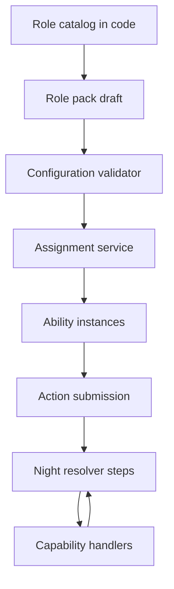

A new role is a definition. If its capabilities already exist, the resolver file does not change. A new capability adds one handler module and a registry entry. A rare special rule uses `handlerKey` and still runs inside an existing step. A plugin loader, hot-reload catalog, or database-edited scripting language is out of scope.

### Sample definition

The Seeker sample in the role catalog is the template: two abilities, `INVESTIGATE` and `ROLE_REVEAL`, infection behavior `LOSE_ROLE_AND_CONVERT_TO_INFECTED_WOLF`, victory type `TEAM`.

### Execution

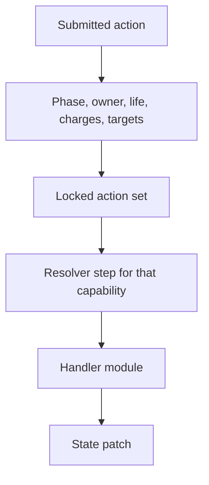

Handlers receive the snapshot, the action, and a patch accumulator. They do not query other players' hidden data except through snapshot fields the step is allowed to read. Investigate handlers read the start-of-night copy. Kill handlers append an attack. They do not themselves decide that the player dies. Death is step 12.

---

## 7. Domain model

Aggregate root: **Game**.

| Entity | Relationship |
|---|---|
| GamePlayer | Many per game. One token, one seat |
| RoleAssignment | One per player |
| AbilityInstance | Many per assignment |
| GameConfiguration | Draft before start, snapshot after |
| Round and phase | Fields on the game plus append-only history via events and resolution runs |
| NightAction | Many per round, one per ability |
| Vote | Many per ballot, one current vote per player |
| InfectionRecord, InvestigationRecord, EliminationRecord, RoleConversionRecord | Append-only facts |
| VictoryRecord | Team or individual |
| GameEvent | Append-only delivery log |
| RolePack | Static data, not a row, identified on the snapshot |

Services to build, and the ones not to split out:

| Service | Responsibility |
|---|---|
| LobbyService | Rooms, seats, tokens |
| GameConfigurationService | Draft save and snapshot freeze |
| ConfigurationValidator | Pure checks |
| RoleRegistry | Read catalog |
| RoleAssignmentService | Shuffle and insert |
| GamePhaseService | Legal transitions and timers |
| NightActionService | Validate and store actions |
| NightResolutionService | Lock, call `resolveNight`, persist |
| VotingService | Ballots and tallies |
| VictoryService | Pure evaluator used by night and day |
| ProjectionService | Public, player, and host views, plus event append |
| HostControlService | Close window, confirm target, cancel, transfer. No rule logic of its own |

Infection, investigation, and protection are handlers inside the domain package, not top-level application services. A separate service for each would scatter one transaction.

---

## 8. Lifecycle

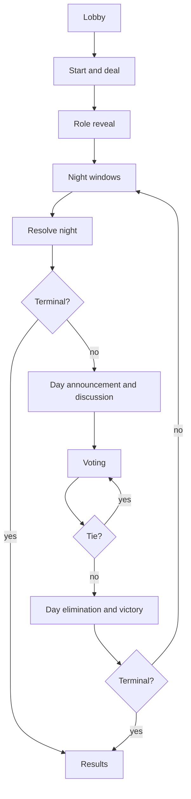

A second tie does not loop forever. The recommended rule eliminates nobody and returns to night.

### Night and day states

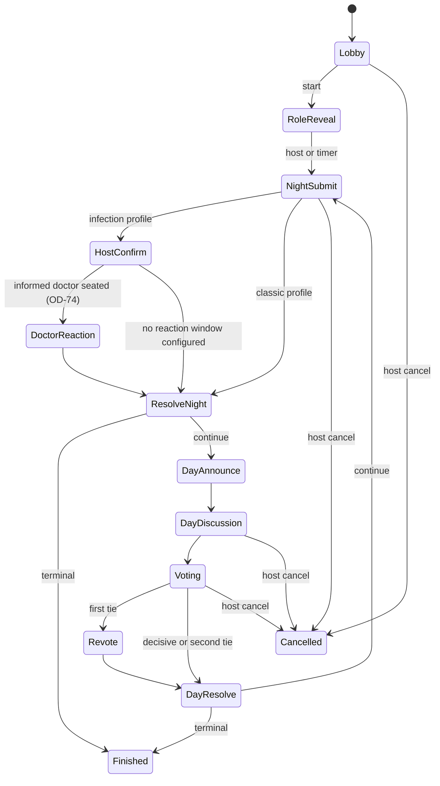

Implemented in WW-501 to WW-503 as `planClose`, `positionAfter`, and `PHASE_TRANSITIONS` in `packages/domain/src/phase/machine.ts`. Two details the diagram leaves out: the host may cancel from any active phase, and with voting turned off, closing day discussion runs the day resolution directly.

### Assignment

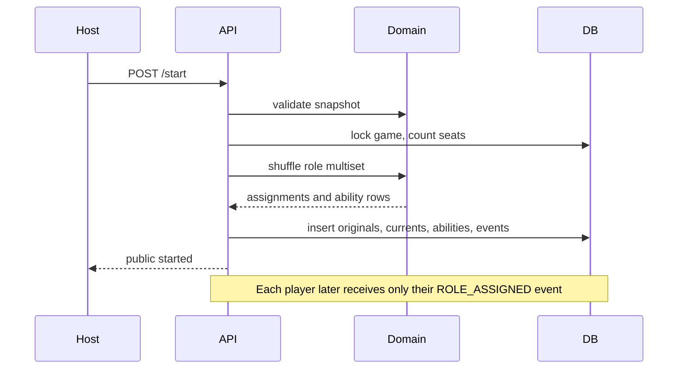

### Elimination

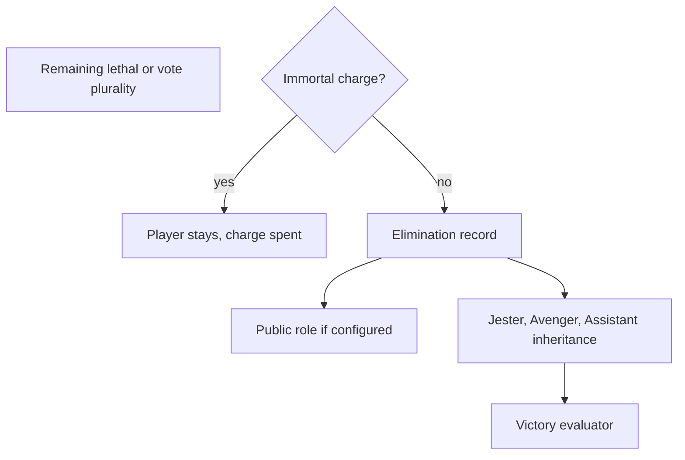

### Victory

```mermaid
flowchart TD
  deaths[Deaths and conversions applied]
  individual[Record individual triggers]
  revoke[Revoke wins whose roles were lost]
  teams[Evaluate Village and Wolf Pack]
  teams --> terminal{Team terminal?}
  terminal -->|yes| end[End with team and recorded individuals]
  terminal -->|no| empty{No Village and no Pack left?}
  empty -->|yes| solo[End with qualifying individuals or draw]
  empty -->|no| continue[Next phase]
```

---

## 9. Night resolution and infection

The ordered steps, protection matrix, and worked examples are in [night-resolution.md](./night-resolution.md). The design choice is a fixed pipeline with named toggles. Hosts do not permute steps in version 1.

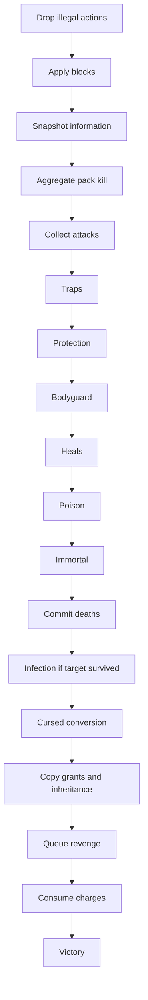

### Infection conversion

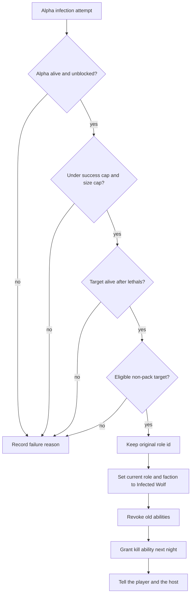

Same-night actions of the old role still resolve before this conversion, under the recommended rule OD-07.

---

## 10. Database

PostgreSQL schema, unique keys, and the recovery scan are specified in [data-model.md](./data-model.md).

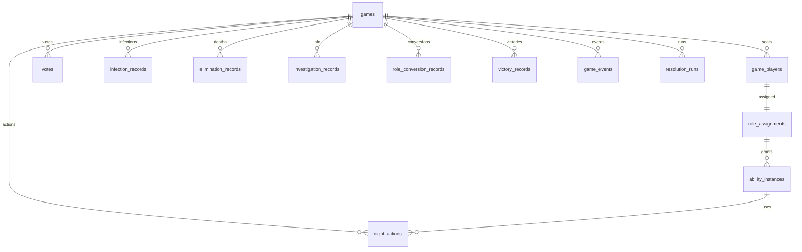

Transactional rules:

- Start, night resolve, and vote close each lock the game row and bump `state_version`.
- One `resolution_run` per round and phase kind.
- Original role columns are inserted and never updated.
- Events are inserted, never updated.
- The configuration snapshot is copied at start and then treated as immutable.

Many rooms are many `games` rows. No process-global "current game" exists.

---

## 11. API and realtime

Contracts are in [api-design.md](./api-design.md). Grouping:

| Group | Representative routes |
|---|---|
| Lobby | `POST /games`, `POST /games/join`, `POST /games/:id/start` |
| Configuration | `GET` and `PUT /games/:id/configuration` |
| Catalog | `GET /role-catalog`, `GET /role-packs` |
| Secrets | `GET /games/:id/me`, `GET /games/:id/host/roster` |
| State | `GET /games/:id/state`, `GET /games/:id/events` |
| Actions | `POST /games/:id/actions` for every capability |
| Host night | `POST /games/:id/host/kill-target`, `POST /games/:id/host/resolve-night` |
| Voting | `POST /games/:id/votes`, `POST /games/:id/host/voting/close` |
| Results | `GET /games/:id/results` |

There is no public assign-role or set-winner route.

### Frontend and backend

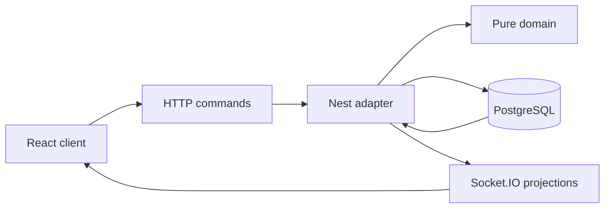

Commands are HTTP so idempotency lives in one place. After commit, the API appends `game_events` and emits to `public`, `player:{id}`, or `host`. Reconnect uses `afterSeq`.

Secret events and their audiences are tabulated in the API design. The rule is: write a payload that is already safe for that audience. Do not rely on the client to hide fields.

---

## 12. Frontend

Screen list, component map, and the capability-driven action panel are in [ui-ux-plan.md](./ui-ux-plan.md).

Required surfaces: home, configuration, role catalog, lobby, reveal, night, night results, day, voting, host dashboard, results.

Desktop and landscape share `GameLayout`: scene, player grid, action row, and discussion rail. Short landscape merges the top bars and scrolls the player grid inside the stage. Portrait stacks the same regions and keeps the action row pinned. Host configuration uses a step rail beside the canvas whenever the viewport is landscape or desktop, and one step at a time in portrait. The host dashboard uses that same sidebar pattern.

The configuration screen is part of the lobby and is host-only for edits. It shows derived faction totals and validator output. Infection Core locks the 20-player composition. Unresolved roles appear disabled.

The player table never renders another player's hidden role. The host dashboard does, on a host route backed by the host endpoint.

The Android package is specified in the UI plan. Capacitor copies the Vite build into `apps/web/android`. The debug artifact is a sideload APK. Release signing uses a keystore that stays out of git.

---

## 13. Balancing

The validator warns. It does not pretend to know a fair win rate.

| Check | Threshold |
|---|---|
| High starting wolf ratio | Above 0.30 |
| Low wolf ratio without infection | Below 0.10 |
| Infection can reach parity with no deaths | Wolf cap at least half the seats |
| Information density | Above `max(2, floor(players / 8))` |
| Protection density | Above 3 when players are 15 or fewer |
| Neutral density | Above `floor(players / 5)` |
| Informed unlimited Doctor | Always surfaced as an info warning |

Headcount suggestions, exact proposed compositions for 10, 15, 20, 24, and 30, and the statement that they are unmeasured, are in the configuration document.

Infection Edition's structural risk: if OD-02 is the informed unlimited veto, wolves depend on infection and votes until the Doctor is gone. Measure this with the simulator before changing a confirmed bullet.

Pack 2A is a legal reconstruction because the brief's expanded arithmetic does not form one consistent 20-player list. It is marked unconfirmed.

---

## 14. Security

The server is the only authority for dealing, targets, charges, votes, resolution, conversion, and victory.

| Threat | Control |
|---|---|
| Client edits its role | Roles are not accepted from the client |
| Player calls another seat's ability | Ability lookup is scoped to the token's player id, else 404 |
| Dead or wrong-phase action | 409 |
| Replay | Idempotency key plus locked phase |
| Secret in a public event | Audience-specific rows. Tests scan payloads |
| Secret in an error | Generic messages |
| Host route as a player | 403 |
| Cross-room token | 404 |
| Forged socket event | Server ignores client game events |
| Double resolution | Row lock, version, unique resolution run |
| Peek by cancelling | Cancelled results omit roles |
| Multi-account | Guest tokens cannot stop it. OD-63. Rate-limit joins and say so in the UI |
| Timing of actions | Server clock and phase, not the client timestamp |
| Information in the host UI | Accepted. The host is the moderator |

Tokens are random, stored as hashes, and shown once. Logs use ids.

---

## 15. Edge cases

The case-by-case table of infection, abilities, protection, neutrals, voting, and restarts is in [game-rules.md](./game-rules.md). Each row names the owning component, the validation, and whether a decision is still open.

Highest-risk cases to test first:

- Alpha dies on the same night as their infection attempt.
- Guard protects a player who is also infected.
- Informed Doctor vetoes the only kill while infection converts someone else.
- Doctor is infected after saving themselves.
- Tie vote, then a second tie.
- Two resolvers.
- Reconnect after a private investigation event.
- Jester eliminated on the vote that also creates wolf parity.

---

## 16. Testing

The plan is in [testing-plan.md](./testing-plan.md). The resolver is pure, so the infection matrix runs without PostgreSQL. API tests cover projections, locks, and restart. Playwright covers the seven viewports in the UI plan. Landscape and desktop assert the same regions. An install smoke test covers the debug APK in both orientations. The simulator runs thousands of games with bots that see only their projection.

---

## 17. Roadmap

### Parallel work

After the domain types exist, catalog and validator work (Phase 2) can proceed beside lobby HTTP (Phase 3). The web lobby can use fixture validation before the database is connected, then switch to the API. Role-family tasks in Phase 10 split by investigation, protection, offense, neutral, and support after the resolver pipeline exists. Phase 12 builds the shared gameplay layout once, then checks it at every viewport in the UI plan. The APK in Phase 16 waits on that client and a reachable API, not on every expanded role.

### Dependency graph

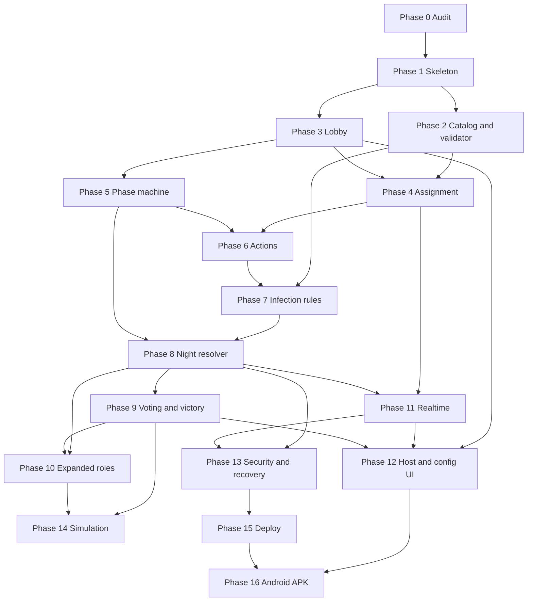

### Phase 0 — Repository audit

| | |
|---|---|
| Objectives | Know what already exists before designing on top of it |
| Features | Written audit |
| Backend / frontend / database / API / events | None |
| Dependencies | None |
| Risks | A nested empty git root is easy to miss and document as if a parent app existed |
| Acceptance | Section 2 of this plan matches the checkout |
| Tests | None |
| Complexity | S |
| Priority | P0, done |

### Phase 1 — Skeleton

| | |
|---|---|
| Objectives | Freeze OD-60 and create the four packages plus PostgreSQL |
| Features | Workspace, health check, domain types |
| Backend | Nest app shell |
| Frontend | Vite shell and router placeholders |
| Database | Compose file and the first migration |
| API | `GET /health` |
| Events | None |
| Dependencies | OD-60 |
| Risks | Choosing a stack and then putting rules inside the framework |
| Acceptance | Domain tests run with no database. The API boots |
| Unit tests | Package boundary test that domain imports stay pure |
| Integration tests | Health check |
| Complexity | M |
| Priority | P0 |

### Phase 2 — Catalog and configuration

| | |
|---|---|
| Objectives | Register every role and reject illegal games |
| Features | 37 definitions, packs, validator |
| Backend | Pure modules only |
| Frontend | None required, though fixture summaries help |
| Database | None |
| API | None until lobby |
| Events | None |
| Dependencies | Phase 1 |
| Risks | Inventing Priest, Hermit, Confuser, or Bard powers while typing the catalog |
| Acceptance | Infection Core validates. Unresolved roles and bad arithmetic do not |
| Unit tests | Every validator code |
| Integration tests | None |
| Complexity | L |
| Priority | P0 |

### Phase 3 — Lobby

| | |
|---|---|
| Objectives | Rooms that reach a valid full table |
| Features | Create, join, code, draft configuration |
| Backend | LobbyService |
| Frontend | Home and lobby |
| Database | `games`, `game_players` |
| API | Lobby and configuration routes |
| Events | Optional `PLAYER_JOINED` if sockets land early. HTTP polling is acceptable until Phase 11 |
| Dependencies | Phases 1 and 2 |
| Risks | Room codes that are too short, and host leave deleting an active game later |
| Acceptance | Two clients join. Start is refused until valid and full |
| Unit tests | Code generator alphabet |
| Integration tests | Join conflicts |
| Complexity | M |
| Priority | P0 |

### Phase 4 — Assignment and secrets

| | |
|---|---|
| Objectives | Deal and project secrets |
| Features | Start game, `/me`, host roster, reveal UI |
| Backend | Assignment and projection services |
| Frontend | Reveal card |
| Database | Assignments and ability instances |
| API | Start, me, roster |
| Events | `ROLE_ASSIGNED`, `HOST_ROSTER_READY` when sockets exist |
| Dependencies | Phases 2 and 3 |
| Risks | A shared DTO that includes the full roster for every caller |
| Acceptance | Non-host payload test fails if another role id appears |
| Unit tests | Shuffle counts |
| Integration tests | 20-player deal |
| Complexity | M |
| Priority | P0 |

### Phase 5 — Phase machine

| | |
|---|---|
| Objectives | Legal night and day movement, including optional windows |
| Features | Host pace and timers |
| Backend | GamePhaseService |
| Frontend | Phase banner fed by HTTP state until sockets arrive |
| Database | Phase columns and deadlines |
| API | Close-phase |
| Events | Phase events in Phase 11 |
| Dependencies | Phase 3. Doctor window behavior depends on OD-02 |
| Risks | Encoding every role exception as a phase |
| Acceptance | Classic skips confirm and reaction. Infection does not |
| Unit tests | Transition table |
| Integration tests | Version conflict |
| Complexity | M |
| Priority | P0 |

### Phase 6 — Ability execution

| | |
|---|---|
| Objectives | One submit path for every capability |
| Features | Charges, targets, idempotency, action panel |
| Backend | NightActionService and handler registry |
| Frontend | Generic action panel |
| Database | `night_actions`, idempotency |
| API | `POST /actions` |
| Events | `ACTION_SUBMITTED` later |
| Dependencies | Phases 4 and 5 |
| Risks | Per-role endpoints creeping back in |
| Acceptance | A fixture ability submits through the same route |
| Unit tests | Target and charge rules |
| Integration tests | Idempotency replay |
| Complexity | L |
| Priority | P0 |

### Phase 7 — Infection rules

| | |
|---|---|
| Objectives | Encode the default game's abilities |
| Features | Alpha, infected kill, Seeker, Guard, Doctor profiles, Witch, Villager |
| Backend | Handlers and Infection Core preset |
| Frontend | Prompts for those capabilities |
| Database | None beyond ability config |
| API | None new |
| Events | None new |
| Dependencies | Phase 6 and OD-01, OD-02, OD-03 |
| Risks | Merging the two Doctor profiles |
| Acceptance | Confirmed infection bullets have tests |
| Unit tests | Infection matrix |
| Integration tests | Covered more deeply in Phase 8 |
| Complexity | L |
| Priority | P0 |

### Phase 8 — Night resolver

| | |
|---|---|
| Objectives | One deterministic commit per night |
| Features | Pipeline, host confirm, private results |
| Backend | `resolveNight` and NightResolutionService |
| Frontend | Doctor prompt and host target picker |
| Database | Resolution runs, infections, investigations, eliminations, conversions |
| API | Kill-target and resolve-night |
| Events | Elimination, investigation, infection, conversion |
| Dependencies | Phases 5 and 7 |
| Risks | Applying infection before death, or emitting events before commit |
| Acceptance | Golden same-night fixtures and a double-resolve test |
| Unit tests | Pipeline examples |
| Integration tests | Transaction rollback leaves the phase unchanged |
| Complexity | XL |
| Priority | P0 |

### Phase 9 — Voting and victory

| | |
|---|---|
| Objectives | End games correctly, including non-terminal individual wins |
| Features | Ballots, revote, winners, results |
| Backend | VotingService and VictoryService |
| Frontend | Ballot and results |
| Database | Votes and victory records |
| API | Votes and close |
| Events | Voting events and `GAME_COMPLETED` |
| Dependencies | Phase 8 for shared death hooks such as Immortal |
| Risks | Ending the game on every Jester |
| Acceptance | Equality is a wolf win. Jester continuation is tested |
| Unit tests | Tally and victory order |
| Integration tests | Tie revote |
| Complexity | L |
| Priority | P0 |

### Phase 10 — Expanded roles

| | |
|---|---|
| Objectives | Add catalog roles in families without rewriting the pipeline |
| Features | Investigation, protection, offense, neutrals, support, Pack Wolf |
| Backend | Handlers and pack drafts |
| Frontend | Only where a capability needs a new control, such as two targets or a question id |
| Database | None if existing JSON config is enough |
| API | None if submit stays generic |
| Events | Reuse investigation and elimination |
| Dependencies | Phases 8 and 9 |
| Risks | Sneaking unresolved Hermit, Confuser, Priest, or Bard behavior into a preset |
| Acceptance | Each family matches the catalog. Unresolved roles still fail validation |
| Unit tests | One fixture per role profile |
| Integration tests | One game per shippable pack |
| Complexity | XL overall, M per family |
| Priority | P1 |

### Phase 11 — Realtime

| | |
|---|---|
| Objectives | Live tables and reliable private delivery |
| Features | Rooms, catch-up, banners |
| Backend | Socket gateway |
| Frontend | Subscription and refetch |
| Database | Existing `game_events` |
| API | `GET /events` |
| Events | The catalog in the API design |
| Dependencies | Projections and committed events |
| Risks | Emitting one secret payload to the public room |
| Acceptance | A villager socket test fails if it hears a Seeker result |
| Unit tests | Audience filter |
| Integration tests | Reconnect |
| Complexity | M |
| Priority | P0 for Infection play, after the HTTP game works |

### Phase 12 — Host and configuration UI

| | |
|---|---|
| Objectives | A host can configure, operate, and explain a game on the shared layout |
| Features | Catalog browser, dashboard, recap, `GameLayout` for desktop and landscape, portrait reflow |
| Backend | Dashboard read model if the roster route is not enough |
| Frontend | The screens in the UI plan, on one `GameLayout` |
| Database | None |
| API | Existing host routes |
| Events | Dashboard listens to host events |
| Dependencies | Phases 3, 9, and 11 |
| Risks | Shipping a second layout for phones, hiding the action row on a short landscape screen, or a control that writes rules the API does not allow |
| Acceptance | Create, join, lobby, reveal, night, day, vote, and host dashboard work at the seven viewports in the UI plan. Landscape and desktop show the same regions. Invalid games do not start. A player cannot open the dashboard data |
| Unit tests | Summary derivation |
| Integration tests | Playwright projects for lobby, reveal, action, vote, and host dashboard |
| Complexity | L |
| Priority | P0 for the shared layout, configuration, and the viewport set |

### Phase 13 — Security and recovery

| | |
|---|---|
| Objectives | Make the authority rules stick under abuse and restarts |
| Features | Rate limits, generic errors, boot recovery, log hygiene |
| Backend | Hardening |
| Frontend | Session loss message |
| Database | No new secrets |
| API | 429 behavior |
| Events | Replay after boot |
| Dependencies | Phases 8 and 11 |
| Risks | Recovery double-applying a timed phase |
| Acceptance | The security and restart tests pass |
| Unit tests | Error serializer |
| Integration tests | Restart and cross-game token |
| Complexity | M |
| Priority | P0 before any shared deployment |

### Phase 14 — Simulation

| | |
|---|---|
| Objectives | Measure presets with honest bot limits |
| Features | Seeded batch runner and a 10,000-game Infection report |
| Backend | Domain command |
| Frontend | Optional later display of a named report |
| Database | Not required |
| API | None |
| Events | None |
| Dependencies | Victory evaluator. Expanded reports wait for Phase 10 |
| Risks | Bots that read the full roster and produce a flattering fake balance |
| Acceptance | The report names seed, policy, and sample size |
| Unit tests | Projection passed to the bot excludes other roles |
| Integration tests | 1,000-game smoke |
| Complexity | L |
| Priority | P1 |

### Phase 15 — Deployment

| | |
|---|---|
| Objectives | Run one production-shaped stack |
| Features | Compose, migrations, request logs |
| Backend | Process configuration |
| Frontend | Static build served by the web container |
| Database | Volume and backup note |
| API | Health |
| Events | Sticky sessions or a later Redis adapter if a second API node is added |
| Dependencies | Phase 13 |
| Risks | Two API nodes with in-memory sockets and no Redis, which split rooms |
| Acceptance | Document single-node sockets until a Redis adapter exists |
| Unit tests | Config parser |
| Integration tests | Boot against an empty volume |
| Complexity | M |
| Priority | P1 |

### Phase 16 — Android APK

| | |
|---|---|
| Objectives | Package the responsive client as a sideloadable Android APK |
| Features | Capacitor project, debug APK, Preferences token storage, build-time API origin |
| Backend | None beyond a reachable HTTPS or LAN debug API |
| Frontend | Same Vite build wrapped by Capacitor. No separate Android screens |
| Database | None |
| API | Existing player and host routes |
| Events | Existing Socket.IO rooms over the configured API origin |
| Dependencies | Phase 12 flows (create, join, lobby, reveal, table, vote) on the shared layout. Phase 15 or a local API that the phone can reach |
| Risks | Pointing the APK at localhost, omitting safe-area insets, locking orientation, or starting a React Native rewrite |
| Acceptance | `assembleDebug` produces an installable APK. Create or join works against a configured API origin. Token survives app restart via Capacitor Preferences. Only the INTERNET permission is declared |
| Unit tests | Token storage adapter selects Preferences in native and sessionStorage on web |
| Integration tests | Install smoke: open the app, create or join, restore the token after process kill |
| Complexity | M |
| Priority | P1 after the shared layout exists |

---

## 18. Critical design decisions

### 1. How can a new role be added without changing the engine?

**Recommended.** Add a catalog definition that composes existing capabilities. Register a new handler only when a new capability or `handlerKey` is required. Leave the step list alone.

**Alternative.** A switch on role id inside `resolveNight`, or a runtime plugin system.

**Trade-off.** The catalog approach needs discipline when a role does not fit a capability. The switch approach is faster for three roles and brittle at 37. A plugin system solves a packaging problem this repository does not have.

**Impact.** No existing code. New roles touch the catalog, one handler at most, tests, and optionally a pack.

**Depends on.** WW-201, WW-602, WW-801.

### 2. How can one role belong to different teams?

**Recommended.** `allowedFactions` on the definition and `faction` on the configuration entry. The assignment stores that choice in `original_faction`. Later conversions change `current_faction` only.

**Alternative.** Separate role ids per team, such as `village_assassin` and `wolf_assassin`.

**Trade-off.** One id keeps the catalog smaller and needs validator checks. Duplicate ids make illegal factions harder to express and harder to balance.

**Impact.** None today.

**Depends on.** WW-201, WW-203, WW-402.

### 3. How can infection permanently remove the original role?

**Recommended.** Keep `original_role_id`. Set `current_role_id` to `infected_wolf`. Revoke ability rows with reason `INFECTION`. Insert the wolf kill ability for the next round. Do not delete the assignment.

**Alternative.** Overwrite a single role column and rely on logs to remember the past.

**Trade-off.** Two columns make the recap and the auditor straightforward. A single column risks a bug that restores a Seeker ability after infection.

**Impact.** None today.

**Depends on.** WW-401, WW-701, WW-801.

### 4. How can a role have several abilities?

**Recommended.** `abilities[]` on the definition and one `ability_instances` row each. The Witch is the confirming example: save and poison are independent rows with independent charges.

**Alternative.** One row with a bitmask.

**Trade-off.** Rows match charges, revocation, and copy grants. Bitmasks get smaller and become opaque.

**Impact.** None today.

**Depends on.** WW-201, WW-401.

### 5. How can abilities have different limits and cooldowns?

**Recommended.** Per-ability fields: `usesPerGame`, `usesPerNight`, `cooldownNights`, `availableFromRound`, and constraint objects such as "not the same target as last round." The profile can override them per preset. `null` charges mean unlimited, which is how Infection Doctor stays out of the limited profile.

**Alternative.** Global constants per capability.

**Trade-off.** Per-ability config supports two Doctor profiles. Global constants would force the limited Expanded Doctor to share the Infection rule.

**Impact.** None today.

**Depends on.** WW-202, WW-603.

### 6. How can neutral roles win independently?

**Recommended.** Victory objects on the role, state on the assignment, and an evaluator that records individual wins before team wins. `endGameOnIndividualWin` defaults false. Jester's day-vote trigger is the confirmed example.

**Alternative.** End the whole game on the first individual win.

**Trade-off.** Continuation matches the brief's requirement that an individual win does not automatically finish the table. It also means the UI must show a win that is not the final screen yet.

**Impact.** None today.

**Depends on.** WW-902, OD-08.

### 7. How can role packs be reused?

**Recommended.** Packs are configuration documents compiled through the same validator as a custom draft. Starting a game copies the chosen draft into `config_snapshot`.

**Alternative.** A module per mode with its own resolver.

**Trade-off.** Data packs can drift if someone special-cases Infection inside the resolver. Reviews should reject mode switches in `resolveNight`. Profiles may select a kill aggregator. They may not copy the pipeline.

**Impact.** None today.

**Depends on.** WW-204.

### 8. How can the host build a custom game?

**Recommended.** Lobby editor writes a draft. The server validates on save and again on start. Derived counts drive the summary. Unresolved roles are disabled. Warnings require acknowledgement. Errors block start.

**Alternative.** A free-form rules text the host enforces socially.

**Trade-off.** Structured drafts are implementable and limited. They cannot express Confuser until a real ability exists, which is the desired limit.

**Impact.** None today.

**Depends on.** WW-303, WW-1201.

### 9. How can simultaneous actions resolve deterministically?

**Recommended.** Close the window, sort by step order and then action id, run the pure function, persist one resolution row. Information uses the start-of-night snapshot. No randomness in the resolver.

**Alternative.** Resolve each action at the moment it arrives.

**Trade-off.** Closed-window resolution matches hidden night actions and is replayable. Arrival-order resolution rewards latency and leaks timing.

**Impact.** None today.

**Depends on.** WW-801, OD-38.

### 10. How can copied or transformed abilities be handled?

**Recommended.** Shapeshifter schedules a new ability instance with `source: COPY`, fresh charges, and `expires_round`. It cannot target infection, a Shapeshifter, or another copy. Cursed and infection use the conversion path instead of copying.

**Alternative.** Mutate the target's charges, or replace the Shapeshifter's role id permanently.

**Trade-off.** A parallel instance avoids draining the victim and avoids recursive copies. It can still be too strong if it copies the informed Doctor, so that copy is off by default.

**Impact.** None today.

**Depends on.** WW-1005, OD-31, OD-58.

### 11. How can duplicate actions be prevented?

**Recommended.** Unique `(game, round, ability instance)` plus idempotency keys. Replacement is allowed only while status is `PENDING`. Phase lock flips them to `LOCKED`. Resolution uniqueness is a second guard.

**Alternative.** Trust the client disable flag.

**Trade-off.** Two database constraints cover retries and hostile clients. The UI disable is only a convenience.

**Impact.** None today.

**Depends on.** WW-601, WW-802.

### 12. How can secret information be protected?

**Recommended.** Three projections, audience-specific event rows, generic errors, token-scoped queries, and tests that serialize a villager view and fail on foreign role ids. Wolf anonymity is the absence of teammate fields, not a filtered list the client hides.

**Alternative.** Encrypt the roster in the client.

**Trade-off.** Server projections fail closed. Client encryption still means the server sent the secret.

**Impact.** None today.

**Depends on.** WW-403, WW-804, WW-1101, WW-1301.

### 13. How can a game recover after a restart?

**Recommended.** Store phase, actions, votes, and events in PostgreSQL. On boot, resume host-paced games in place and enqueue overdue timed transitions. Clients present the token and `afterSeq`. Do not re-run a round that already has a resolution row.

**Alternative.** Keep the live game only in memory.

**Trade-off.** Database state survives crashes and makes the function pure code easier to retry. It requires careful transactions, which the design already wants for cheating resistance.

**Impact.** None today.

**Depends on.** WW-802, WW-1302.

### 14. How can many rooms run at once?

**Recommended.** Every row and socket room includes `game_id`. The API is stateless aside from sockets. One node uses an in-memory socket adapter. A second node requires a Redis adapter and still uses PostgreSQL for authority.

**Alternative.** One process per game.

**Trade-off.** A shared service is enough for party-sized concurrency and needs locks. A process per game isolates faults and complicates deployment long before the user count requires it.

**Impact.** None today.

**Depends on.** WW-301, WW-1501.

### 15. How can balance be evaluated objectively?

**Recommended.** Validator warnings for structural ratios, plus a seeded simulator whose bots receive only player projections. Publish sample size, seed, policy, and Doctor-veto rate. Do not print a win probability without that report.

**Alternative.** Hand-authored "fair" labels, or bots that can see every role.

**Trade-off.** Honest bots play worse than humans and will mis-estimate social deception. They still catch mechanical stalls, such as an informed Doctor negating every kill. Omniscient bots would hide that stall's effect on night deaths and should not be used for the headline numbers.

**Impact.** None today.

**Depends on.** WW-1401, WW-1402.

---

## 19. Risks to close before building gameplay

| Risk | Why it matters | When |
|---|---|---|
| OD-01, OD-02, OD-03 | They change the Infection night | Before WW-701 is treated as final |
| Informed Doctor balance | May remove night kills as a wolf tool | Acknowledge before playtest, measure in WW-1402 |
| OD-60 stack | All packages depend on it | Before WW-102 |
| Missing images and Pack 2 arithmetic | Expanded preset must stay labeled as a reconstruction | Before calling Pack 2A canon |
| Unresolved Hermit, Confuser, Priest, Bard | Inventing powers would violate the brief | Keep WW-1006 in every milestone |
| Guest multi-accounting | A player can hold two seats | Say so in the lobby. Accounts are a later project |
| Single-node sockets | A second API replica splits rooms | Document until Redis exists |
| Host is all-seeing | Acceptable for this game, fatal if a future mode removes the host | Keep host routes out of player tokens |
| Two gameplay layouts | Landscape becomes a squashed portrait page, or desktop hides actions a phone needs | Build `GameLayout` once in WW-1204 and require WW-1205 before Phase 12 is accepted |
| APK API origin | A phone cannot use the developer's localhost | Set a build-time origin. Cleartext only in debug |

---

## 20. Planning acceptance

| Requirement | Where it is satisfied |
|---|---|
| Repository inspected and emptiness recorded | Section 2 |
| Infection Edition specified | Section 4 and game-rules |
| All brief roles included, variants kept | Role catalog |
| Registry and capabilities | Section 6 |
| Modes, packs, custom validation | Role configuration |
| Neutral victories | Game rules and OD-08, OD-50 |
| Night priorities | Night resolution |
| Edge cases | Game rules |
| Database and API | Data model and API design |
| Frontend and host | UI plan |
| Shared desktop and landscape layout, portrait reflow, Android APK | UI plan sections 3–4 and 11–12, Phase 16, OD-71 |
| Security | Section 14 |
| Tests | Testing plan |
| Phases | Section 17 and the checklist |
| Unresolved rules | Open decisions |

A developer can start at WW-101 after OD-60, and can implement the resolver against the recommended Infection strategies while the product owner confirms or replaces OD-01, OD-02, and OD-03.
