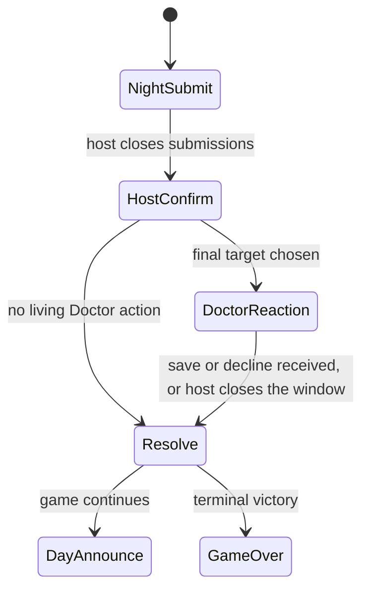

# Night Resolution

Night resolution is a pure function over a snapshot and a closed set of actions. The phase service decides when the set is closed. The function does not read the clock, the socket layer, or the database.

```text
resolveNight(snapshot, actions, config) -> ResolutionResult
```

The result contains deaths, conversions, private information records, charge updates, victory updates, and public facts. The application service writes that result in one transaction.

Cross-references: [game-rules.md](./game-rules.md), [open-decisions.md](./open-decisions.md).

---

## 1. Windows before the function runs

Infection Edition, if the recommended decisions are accepted:



Classic `classic-v1` goes from Night Submit to Resolve. Majority aggregation happens inside the function. Blind Doctor and Guard actions are ordinary submissions.

A player who disconnects does not reopen a window. A missing Doctor decision is a decline. A missing wolf submission is no target from that wolf.

Actions are replaceable until their window closes. After close, the row is locked.

---

## 2. Pipeline

Steps run in this order for every profile. A toggle can change what a step does. Version 1 does not let the host move steps.

| Step | Name | What it does |
|---:|---|---|
| 1 | Drop illegal actions | Remove actions whose actor was dead at submission close, whose ability is revoked, whose charges are empty, whose target fails the ability target rule, or whose phase does not match |
| 2 | Apply blocks | Cancel special actions of players named by an accepted Disruptor action. Cancelled actions produce no visits and no effects |
| 3 | Capture information snapshot | Alignment, category, role id, Psychic comparison, and Prophet answers are computed from the pre-resolution snapshot |
| 4 | Aggregate pack kill | Build the single final wolf-kill target, or record that there is none |
| 5 | Collect attacks | Final pack kill, Lone Wolf kill, Sniper, poison triggers that are due, and any other `KILL` or due `POISON` |
| 6 | Traps | If a trapped player is a pack-kill target, record attacker ids for the Trapper and cancel those kill contributions when the trap profile says so |
| 7 | Protection | Guard, Shieldbearer, and Blacksmith shields cancel attack types listed on the ability. Default list is `WOLF_KILL` only |
| 8 | Redirect | Bodyguard takes a remaining wolf kill aimed at their protectee |
| 9 | Heals | Witch save and Doctor save cancel a remaining `WOLF_KILL` on their target. Doctor informed mode is simply a heal action whose target was forced to the final kill id |
| 10 | Apply poison | Add poison lethals that are due and were not cancelled by an ability whose `cancels` list contains `POISON` |
| 11 | Immortal | If a player still has a lethal and has a charge, clear that player's lethals for this resolution and consume the charge |
| 12 | Commit deaths | One elimination record per dead player, with ordered causes |
| 13 | Infection | If Alpha's target is alive, eligible, and under the cap, convert |
| 14 | Cursed conversion | A survived wolf-kill attempt converts if the cap allows |
| 15 | Other conversions | Apply scheduled Shapeshifter grants and Assistant inheritance caused by a Doctor death in step 12 |
| 16 | Death triggers | Queue Avenger revenge for the next night when a single responsible player exists |
| 17 | Write information | Persist investigation and tracking records from step 3 and from the visit list |
| 18 | Consume charges | Successful uses, failed illegal uses, and nightly actions that were accepted |
| 19 | Victory | Run the victory evaluator on the resulting living set |
| 20 | Return result | No I/O |

Determinism inside a step: sort by action id. Equal inputs produce equal outputs. There is no `Math.random` in the resolver. Role assignment randomness happens earlier and is stored as the assignment itself.

### Why information is earlier than death

A Seeker who checks the Alpha's target must learn the start-of-night alignment. If infection were applied first, the check would depend on step order and could leak the conversion. OD-38 recommends the start-of-night snapshot. Tracking is different: it reports visits from this night's accepted actions, including actions that are later protected.

### Why infection is after death

OD-03 recommends converting only survivors. The function therefore needs the death set first. Guard protection does not appear in the infection step. A protected player who lives can still convert.

### Why Immortal is after heals

A Doctor or Guard save leaves the charge unused. The charge answers a death that is still going to happen. One charge clears every remaining lethal on that player for this resolution so two simultaneous sources do not create a partial-save argument. The charge is then gone, which prevents a loop.

---

## 3. Pack kill aggregation

### `HOST_SELECT_AMONG_SUBMISSIONS`

The function receives the host decision as an action of capability `KILL` with `source: HOST_CONFIRM`. Validation before resolve:

- At least one wolf submission exists, or the host confirms "no kill."
- The chosen player id is among submitted target ids.
- The chosen player is alive.
- Friendly fire off removes pack members from the legal set.

The function does not invent a target the host did not confirm.

### `MAJORITY`

Count submissions. The unique maximum becomes the final target. A tie yields no kill. This path does not read a host action.

### Lone Wolf

The Lone Wolf attack is never folded into the pack final target. It is a separate attack in step 5. It can be protected by abilities that cancel `WOLF_KILL`.

---

## 4. Visit list

A visit is a targeted action that survived step 2. The Tracker receives the distinct target player ids. The action type is omitted unless `trackerIncludesActionType` is true. Default false.

Multiple wolves visiting one player produce one id for a Tracker who followed a wolf, and several ids if the followed player somehow targeted several people. Abilities in this catalog target one player, except the Psychic, who targets two. Both Psychic targets are visits.

---

## 5. Protection interactions

| Attack | Guard | Shieldbearer | Blacksmith item | Doctor wolf save | Witch save | Bodyguard | Immortal | Trapper |
|---|---|---|---|---|---|---|---|---|
| Pack wolf kill | Cancels | Cancels | Cancels | Cancels if this is the final target | Cancels if aimed here | Redirects if still lethal | Saves the final victim of the redirect or the original | Can cancel and report |
| Lone Wolf kill | Cancels | Cancels | Cancels | Cancels only if this kill is the one the Doctor was shown. In Classic blind mode, only if the Doctor picked this player | Cancels if aimed here | Redirects | Saves | Does not trigger unless configured |
| Infection | No effect | No effect | No effect | No effect | No effect | No effect | No effect | No effect |
| Poison | No effect by default | No effect | No effect | No effect | No effect | No effect | Saves if the poison is lethal this resolution | No effect |
| Sniper | Cancels if the ability lists `SNIPER` | Same | Same | Only when the Doctor action targets that player | Only when the save targets that player | Redirects only if configured. Default wolf kill only | Saves | No effect |
| Day vote | No | No | No | No | No | No | Saves and consumes the charge | No |

Day votes are not part of `resolveNight`. The day elimination function calls the same Immortal, Jester, and Avenger handlers so those rules do not fork.

---

## 6. Infection step in detail

Preconditions:

- Infection is enabled.
- Alpha is alive after step 12.
- Success counter is below 4.
- Living pack size is below the cap.
- The attempt survived the Disruptor.
- The target is alive after step 12.
- The target is eligible and is not already `WOLF_PACK`.

Result:

- Create an infection record with outcome `SUCCESS`.
- Set current role to `infected_wolf` and current faction to `WOLF_PACK`.
- Revoke active abilities with reason `INFECTION`.
- Grant `infected_kill` with `availableFromRound = round + 1`.
- Revoke individual victory attached to the lost role.
- Private event to the converted player and a host event.

Failure reasons stored on the record: `ALPHA_DEAD`, `CAP_SUCCESS`, `CAP_SIZE`, `TARGET_DEAD`, `TARGET_INELIGIBLE`, `BLOCKED`, `SEALED`.

Cursed conversion uses the same grant path and will no-op if the infection step already filled the cap or already converted that player.

---

## 7. Charge consumption

| Situation | Consumption |
|---|---|
| Accepted night action with a nightly limit | Consumes the nightly use even if protection made it redundant |
| Doctor decline | Does not consume an unlimited profile. A limited profile consumes only on an accepted save |
| Witch potion | Consumes when the action is accepted |
| Illegal target rejected before close | Does not consume, because the player may resubmit |
| Illegal target left in place at close | Consumes the night attempt and does not consume a success counter |
| Infection success | Consumes one success |
| Immortal | Consumes only when it cancels a real lethal |
| Copy | Consumes the Shapeshifter's copy use, and later consumes the copied ability's own fresh charges when the copy is used |
| Blocked action | The victim's charge is not consumed. The Disruptor's charge is consumed |

---

## 8. Same-night examples

### Guard and infection on the same villager

The Guard cancels the wolf kill. The villager lives. Infection still converts them. The Guard's action is consumed. The Seeker's result, if they checked that villager, still says Non-Wolf.

### Doctor veto in Infection Edition

The final target is the Seeker. The Doctor spends the veto. Step 9 removes the kill. If the Alpha infected someone else, that other person can still convert. If the Alpha infected the Seeker, the Seeker lives and converts.

### Doctor is the final target

The Doctor can select themselves. The kill is cancelled. An infection on the Doctor still converts the Doctor, and the Doctor ability is revoked after this resolution. They do not receive a second reaction after conversion.

### Witch save and poison on one player

The save removes a wolf kill on that player. The poison record is still created.

### Bodyguard and Guard on one target

The Guard already cancelled the kill, so the Bodyguard does not die. Both nightly uses are consumed.

### Alpha infected and also the final target, Doctor declines

The Alpha dies. Infection is evaluated after death, the Alpha is dead, and the conversion does not happen. Infection becomes sealed because the Alpha died.

### Two wolves submit different targets

Under host select, only the confirmed player is attacked. Under majority with a 1–1 tie, nobody is attacked.

---

## 9. Persistence boundary

The application service:

1. Opens a transaction.
2. Locks the game row and checks `stateVersion` and phase.
3. Loads the snapshot and locked actions.
4. Calls `resolveNight`.
5. Inserts elimination, infection, investigation, conversion, and event rows.
6. Updates assignments, charges, victory rows, phase, and `stateVersion`.
7. Inserts one `resolution_run` with a hash of the input.
8. Commits.
9. After commit, emits socket events from the stored audience fields.

A crash before commit leaves the night unopened. The host or the timer can retry. The input hash makes the retry observable. A second commit is rejected by the unique resolution row.

---

## 10. Day resolution order

Day abilities and votes are separate from the night function.

1. Close day abilities such as Sniper and Seeker reveal.
2. Resolve the Sniper through the protection and Immortal helpers.
3. Open voting only if the game did not end.
4. Close voting and tally weights.
5. On a tie, open one revote.
6. If a single player has the highest weight, create a day elimination.
7. Apply Jester, Immortal, and Avenger handlers to that elimination.
8. Evaluate victory.
9. Open the next night or end.

Elder and Mayor weights are read from modifier rows. Expired modifiers are ignored and then deleted.
