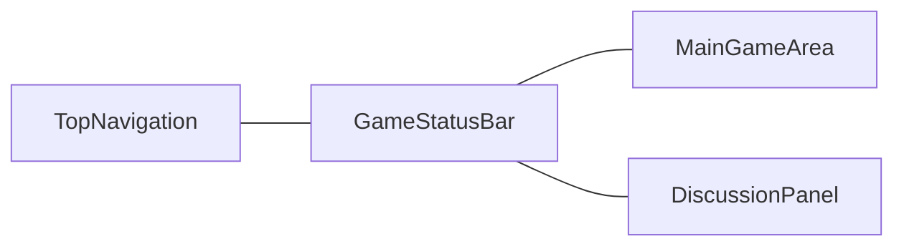
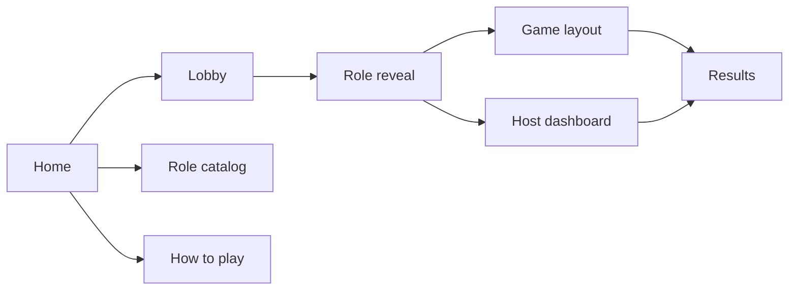

# UI and UX Plan

The repository has no frontend, component library, routes, or design system. This plan specifies a new React + Vite client. Desktop and landscape mobile share one gameplay composition. Portrait is a denser reflow of the same components. The Android APK packages that client. It is the same interface in a WebView.

The client renders server projections. It does not decide kills, infections, votes, or winners. Controls the server would reject stay hidden or disabled. The server remains the check.

Visual reference, layout only:

- [Werewolf Game UI Mockup Grid.png](./Werewolf%20Game%20UI%20Mockup%20Grid.png)
- [Werewolf Infection Edition UI Mockup Grid.png](./Werewolf%20Infection%20Edition%20UI%20Mockup%20Grid.png)

Those images set composition, color, and screen inventory. They are not a license to copy another product's artwork or wordmark. Illustrated backgrounds, avatars, and role art are original assets made for this project. Until those assets exist, scenes use a gradient night or day plate and avatars use initials in a reserved frame. No network fetch of untrusted images.

---

## 1. What was inspected

| Path | Finding |
|---|---|
| `apps/web` | Absent. No React tree, router, store, or stylesheet |
| Components | None to reuse as code. The names in the previous plan are the concepts this plan keeps |
| Styling | No MUI, Tailwind, CSS variables, or breakpoints |
| Game screens | Specified below. They are not implemented |
| Chat | No composer, no message table, no socket event. See section 9 |
| Host dashboard | Specified in the API as `GET /games/:gameId/host/dashboard`. No UI |
| Breakpoints | The previous plan keyed layout off width only: one column under 1024px, columns after that |

The previous plan treated a 390px portrait phone as the product and desktop as a later column arrangement. This plan replaces that. Width, height, and aspect ratio choose density. They do not choose a second product.

---

## 2. Visual system

The interface is a dark illustrated table, in the spirit of a social deduction party game. Panels are rounded. Actions are obvious. Phase is visible in the scene, the status line, and the text.

### Theme tokens

Define these as CSS variables and map them into the MUI theme. Components read the variables. Screens do not invent local hex values.

| Token | Role | Starting value |
|---|---|---|
| `--bg` | Page background | `#140b22` |
| `--bg-night` | Night scene wash | `#1a1030` to `#2a1248` |
| `--bg-day` | Day scene wash | `#3a2a68` to `#6b4a2a` |
| `--surface` | Cards and rails | `#241538` |
| `--surface-raised` | Selected and modal surfaces | `#31204c` |
| `--primary` | Primary buttons | `#7c4dff` |
| `--primary-ink` | Text on primary | `#ffffff` |
| `--accent` | Confirm, start, infect, vote | `#f5b942` |
| `--accent-ink` | Text on accent | `#2a1a08` |
| `--wolf` | Wolf team | `#f43f5e` |
| `--village` | Village team | `#34d399` |
| `--neutral` | Neutral and independent | `#c4b5fd` |
| `--text` | Primary text | `#f7f3ff` |
| `--text-muted` | Secondary text | `#c4b6dc` |
| `--border` | Hairline | `rgb(255 255 255 / 0.12)` |
| `--shadow` | Panel shadow | `0 12px 40px rgb(8 4 20 / 0.45)` |
| `--danger` | Destructive host actions | `#fb7185` |

Team color is always paired with a word: Wolf, Village, Neutral, Independent. Life status is always a word: Alive, Eliminated.

### Type, radius, space

Fluid type and space. No fixed page padding.

| Token | Value |
|---|---|
| `--text-title` | `clamp(1.25rem, 1.2vw + 0.9rem, 2.4rem)` |
| `--text-body` | `clamp(0.75rem, 0.2vw + 0.7rem, 1rem)` |
| `--text-label` | `clamp(0.7rem, 0.15vw + 0.65rem, 0.85rem)` |
| `--space` | `clamp(0.5rem, 1vw, 1.25rem)` |
| `--radius` | `clamp(0.75rem, 1vw, 1.25rem)` |
| `--bar` | `clamp(2.5rem, 6vh, 3.5rem)` |
| `--avatar` | `clamp(2.25rem, 5vh, 4.5rem)` |
| `--hit` | `44px`, and `40px` only inside a scrolling player grid when viewport height is under 500px |

Body text stays at least 12px. Hit targets stay at least 40px on a short landscape phone and 44px everywhere else. The player grid scrolls inside its area when twenty seats do not fit. Avatars do not shrink in order to avoid that scroll.

### Styling split

| Tool | Owns |
|---|---|
| CSS variables | Color, type, space, radius, shadow, scene wash |
| CSS Grid | `GameLayout`, setup shell, host shell |
| Flexbox | Card interiors, button rows, avatar rows |
| `clamp()`, `minmax()`, aspect-ratio | Fluid size of scene, avatars, rails |
| Container queries | Avatar density inside `MainGameArea` and rail width inside `DiscussionPanel` |
| MUI | Buttons, tabs, dialogs, text fields, lists, snackbars, focus rings, `aria` behavior |
| Tailwind | Layout utilities where a class is clearer than a one-off rule. Tailwind colors do not override the tokens |

MUI's palette is built from the tokens. One `ThemeProvider` wraps the router. `prefers-reduced-motion` disables the role-reveal motion and leaves the content in its final state.

---

## 3. Responsive model

One gameplay grid runs from a large desktop down through a landscape phone. Portrait changes the grid template. It uses the same components, the same routes, and the same actions.

Layout mode is a function of the viewport, not of a device name:

| Condition | Mode | What changes |
|---|---|---|
| `width >= 1440` and `height >= 800` | Full | Three areas. Wide scene. Rail `clamp(18rem, 22vw, 24rem)` |
| `width >= 1024` and height at least 700 | Compact desktop | Same three areas. Rail `clamp(16rem, 24vw, 20rem)`. Tighter `--space` |
| Landscape and `height >= 500` and `width >= 768` | Landscape tablet | Same three areas. Scene keeps a share of the height. Rail `clamp(14rem, 30vw, 18rem)` |
| Landscape and `width >= 600` and `height < 700` | Landscape phone | Same three areas. Nav and status share one bar. Rail `clamp(11rem, 32vw, 16rem)`. Player grid scrolls inside the stage |
| Landscape and `width < 600` | Narrow landscape | Same stage and action row. The discussion rail collapses to a button until opened. Opening it overlays the stage. The action row stays visible |
| Portrait and `width < 768` | Portrait | Stacked template in section 4. Status and the action row stay pinned |

A 1024×768 tablet is the compact three-area layout because it is short, even though the width is in the desktop band. A 915×412 phone is the landscape-phone layout because the height is the constraint. A 390×844 phone is portrait.

As built (WEB-02): `layoutMode(width, height)` in `apps/web/src/game/layout/layoutMode.ts` is the only copy of these breakpoints. `GameLayout` writes the mode to `data-layout`, and the stylesheet keys off that attribute rather than repeating the numbers in media queries. Landscape means wider than tall, so a square viewport is portrait. The table leaves two gaps, and both get the tablet mode: portrait from 768 to 1023 wide, and near-square landscape windows 600 to 767 wide and at least 700 tall.

Landscape keeps these on screen without a second navigation model:

1. Phase and round.
2. The village scene, or the night selection surface that replaces it during targeting.
3. Living players.
4. The discussion rail, or its open button when the rail is collapsed.
5. The signed-in player's actions.
6. The countdown, or the words "Waiting for host" when no timer is running.
7. Vote or action submit.

Collapsing the rail is allowed only in narrow landscape and only as a visible button. Phase, players, and the current action stay in the stage.

Portrait keeps the same visual system. The scene has a capped height so the action row is on screen. The player list and the discussion log share a segmented control under the scene. Switching that control swaps the middle. It does not unmount the action row. Portrait scrolls inside the middle region. The page itself does not scroll sideways.

The client does not lock orientation and does not show a "rotate your phone" gate.

Safe-area insets pad the shell: `padding: env(safe-area-inset-top) env(safe-area-inset-right) env(safe-area-inset-bottom) env(safe-area-inset-left)`. The primary button clears the bottom inset.

Overflow: the shell is `100dvh` and `overflow: hidden` in landscape and desktop. Each region scrolls on its own. Portrait uses `100dvh` with the middle region as the scroller. No region uses a fixed pixel height that clips a button.

---

## 4. Shared gameplay shell

Day, night, voting, and night results are one `GameLayout`. Lobby and results use it as well. Only the stage content and the enabled actions change.

```text
GameLayout
├── TopNavigation
├── GameStatusBar          (merged into the top bar when height < 700)
├── MainGameArea
│   ├── VillageScene
│   ├── PlayerGrid
│   └── PlayerInteraction  (role action, vote, or result card)
└── DiscussionPanel        (GameEventFeed, and the composer slot in section 9)
```



Desktop and landscape template:

```css
.game-layout {
  display: grid;
  height: 100dvh;
  min-height: 100dvh;
  grid-template-columns: minmax(0, 1fr) var(--rail);
  grid-template-rows: var(--bar) minmax(0, 1fr);
  grid-template-areas:
    "nav rail"
    "stage rail";
}
```

When height is at least 700px, the status line is a second row and both columns share it:

```css
.game-layout.tall {
  grid-template-rows: var(--bar) auto minmax(0, 1fr);
  grid-template-areas:
    "nav nav"
    "status status"
    "stage rail";
}
```

The stage is a grid with a flexible scene and an action row:

```css
.stage {
  display: grid;
  min-height: 0;
  grid-template-rows: minmax(4.5rem, 1fr) auto;
}
.village-scene {
  min-height: 0;
  aspect-ratio: 16 / 9;
  max-height: 100%;
}
```

On a short landscape phone the aspect-ratio yields to `minmax`. The scene stays visible at a minimum of `4.5rem`. The action row is one line: current choice, then the accent button.

Portrait template, width under 768px and height greater than width:

```text
TopNavigation + GameStatusBar
VillageScene          (max-height: 38dvh)
segmented: Players | Log
PlayerGrid or DiscussionPanel
PlayerInteraction     (sticky, above the safe area)
```

```css
.game-layout.portrait {
  grid-template-columns: minmax(0, 1fr);
  grid-template-rows: var(--bar) minmax(5rem, 38dvh) auto minmax(0, 1fr) auto;
  grid-template-areas:
    "nav"
    "scene"
    "switch"
    "middle"
    "action";
}
```

`PlayerInteraction` is the `action` row in every mode. Night targeting, voting, and "Continue to day" are that row. They are not a separate bottom sheet component and not a desktop-only sidebar.

As built (WEB-02), with two decisions:

- `TopNavigation` stays in `AppShell`, above every route, as the lobby already does. `GameLayout` owns the status, stage, rail, and action regions. "Nav and status share one bar" on short screens is a styling rule on `data-status-row="false"`, not a second navigation component.
- In portrait, only a target grid moves under the "Players | rail" switch. Avatars, the night result card, and the victory banner stay over the scene, and the middle shows the rail, whose own Players tab lists the seats. Each stage's placement is `portraitForeground` in `STAGE_SPECS`. The table route also has a `reveal` stage for `ROLE_REVEAL`: the night village with avatars while players read their cards.

### Stage modes

| Phase | Scene | Foreground | Action row |
|---|---|---|---|
| Lobby | Night village | Avatars in the scene, readiness on each | Host: Start. Others: waiting copy |
| Night | Night wash | `PlayerGrid` of legal targets | Submit the current ability |
| Night results | Night village | Public result card | Continue to day |
| Day | Day village | Avatars in the scene | Open voting when the server allows |
| Voting | Day village | `PlayerGrid` of eligible seats | Confirm vote |
| Results | Dawn or dusk village | Victory banner and stat row | Play again, summary |

---

## 5. Navigation



| Route | Who | Shell |
|---|---|---|
| `/` | Anyone | Home scene |
| `/roles` | Anyone. Public catalog | Setup shell |
| `/how-to-play` | Anyone | Setup shell |
| `/lobby/:gameId` | Members | `GameLayout` |
| `/game/:gameId/reveal` | Members, once | Private reveal scene |
| `/game/:gameId` | Players | `GameLayout` |
| `/game/:gameId/host` | Host. Others see a not-available state | Host shell |
| `/game/:gameId/results` | Members after the end | `GameLayout` |

Top navigation on every shell: wordmark, Play, How to Play, Roles, and the seated player's avatar once they have joined. Play returns to the active game when a session exists, and to home otherwise.

Deep links restore through the bearer token in memory plus a session storage slot on web, or Capacitor Preferences in the APK. A lost token in version 1 cannot be recovered, because tokens are not re-issued from a display name. The lobby says that in the info tab of the rail.

---

## 6. Components

These are the only seat, role, chat, and action components. Desktop and portrait import them. There is no parallel mobile set.

| Component | Responsibility |
|---|---|
| `GameLayout` | The grid in section 4 |
| `GameHeader` | Wordmark and primary nav. Used by `TopNavigation` |
| `GameStatusBar` | Phase, round, timer or "Waiting for host" |
| `VillageScene` | Day or night plate. Decorative. No hit targets that exist only in the art |
| `PlayerAvatar` | Initials or original illustration, life ring, host mark, ready mark, selection ring |
| `PlayerGrid` | Legal seats for the current interaction. Dead seats stay visible and are not selectable |
| `PlayerCard` | Public seat: name, life, seat number. A role only when a public event revealed it |
| `RoleCard` | Private reveal and the player's own role modal |
| `RoleBadge` | Short role name on private surfaces and on the host roster |
| `TeamIndicator` | Word plus team color |
| `DiscussionPanel` | Rail chrome, log tab, info tab. Composer slot is section 9 |
| `GameEventFeed` | Public events for players. Host-audience events on the host route only |
| `NightActionPanel` | The current player's ability prompts |
| `TargetSelector` | Legal targets from the server for that ability |
| `VotingPanel` | Eligible living seats, current choice, confirm, revote |
| `CountdownTimer` | Displays `phaseEndsAt`. It does not advance the phase |
| `GameModal` | Confirmations, private role, vote review |
| `HostControlPanel` | Host sections and phase buttons |
| `ResponsiveSidebar` | Setup steps and host sections. Labels hide under 600px width. Icons stay |
| `ConfigSummary` | Derived counts, errors, warnings |

`PhaseBanner`, `EventFeed`, `ActionPanel`, `TargetPicker`, `VoteBallot`, and `Timer` from the previous plan are these components. They are not a second copy.

`NightActionPanel` maps `capability` to a control:

| Capability | Control |
|---|---|
| `INFECT` | "Choose a player to infect" |
| `KILL` | "Choose a kill target" |
| `INVESTIGATE` | "Choose a player to investigate", or two pickers for Psychic |
| `PROTECT` | "Choose a player to protect" |
| `HEAL` | "Save this player" or "Save the announced target" |
| `POISON` | "Choose a player to poison" |
| `TRACK` | "Choose a player to track" |
| `BLOCK_ACTION` | "Choose a player to block" |
| `ROLE_COPY` | "Choose a player to copy" |
| `ROLE_REVEAL` | "Publish a stored result" |
| `DETECT` | "Ask the allowed question" |

There is no separate Seeker screen, Guard screen, or Witch screen. The Witch sees two controls because the projection contains two abilities. A player with nothing to submit sees "Waiting for night to end" in the action row.

Seat buttons and the primary action are keyboard accessible. Selection is a button, not a hover. Phase changes are announced in an aria-live region.

---

## 7. Screens

### A. Home

Full-bleed village at night, moon, and the wordmark. Copy: "Werewolf" and "Infection Edition", with one line that it is a social deduction game. Actions: Create Game, Join Game. Secondary row: Game Modes, Role Library, How to Play.

Create asks for a display name and starts in Infection Edition. Join asks for a room code and a display name.

On a tall viewport the actions sit in a centered column over the scene. When height is under 500px the scene stays on the left and the actions sit in a column on the right, so both buttons remain on screen.

### B. Game configuration

Host-only editing, inside the lobby flow. Players see the same summary and a waiting state. They do not see start, kick, or ability editors.

`SetupLayout` is a step rail plus a canvas:

| Step | Canvas |
|---|---|
| Mode and players | Infection, Classic, Expanded, Custom. Player count. Infection Edition locks the count at 20 |
| Roles | Pack, then the catalog |
| Settings | Timers, voting, reveal, infection announcement, acknowledged rule choices |
| Review | `ConfigSummary` and Start |

The summary stays visible: selected seats, village, wolf pack, neutral, independent, remaining seats, infection cap, errors, warnings. On a short landscape height it becomes a single strip of those counts. Warnings need an explicit acknowledge control before start. Errors name the validator code in a human sentence.

Portrait shows one step at a time and keeps the count strip pinned. Landscape and desktop show the rail and the canvas together.

Ability editors show only the override fields the catalog marks configurable: charges, cooldown, and existing toggles. They do not offer a free-text power. Adding a role increments a count. Removing it returns the seat to the remaining pool. Unresolved roles stay visible and disabled, with the decision id.

### C. Role catalog

`/roles` for anyone, and the same grid inside the host's Roles step.

Filters: All, Wolf, Village, Neutral, Special, plus search. Cards show an illustration or initials, name, team, and one-line power. Opening a card shows the ability sentences and the limits. The public catalog does not show another seated player's assignment, because nobody is seated on this route.

In the host step, a card can add or remove the role. On `/roles` the cards are read-only. Unresolved roles stay disabled.

The grid uses `auto-fill` and `minmax(clamp(7rem, 18vw, 11rem), 1fr)`. On a short landscape height the cards are one horizontal row inside a scroller, with the filters in the step rail.

### D. Game lobby

`GameLayout` in scene-overlay mode. The village shows joined players around the fire. Each avatar has a readiness mark. The rail shows the room code with copy, joined count and required count, the mode, a player list, and tabs for the log and for room info.

Start is enabled only when the server says the draft is valid and the room is full. The accent button is in the action row. A non-host sees "Waiting for the host" in that row.

The info tab states the guest-token limit: one person with several browsers can hold several seats.

### E. Role reveal

A private scene, separate from the public rail, so a secret is not painted beside a shared log.

Landscape and desktop: role illustration on one side, card on the other. Portrait: illustration on top, card below, continue button pinned.

The card shows role name, team, short description, abilities and limits in sentences, and a line about tonight or "You have no night action." Teammates appear only when the projection includes them. Infection Edition omits that block.

The entrance is a short scale-and-fade. `prefers-reduced-motion` shows the final card immediately. "I understand" continues to the table. It does not confirm the role to other players.

The card is readable at arm's length. A control hides it. That reduces shoulder-surfing at a shared table. It is a product note, not a security claim.

### F. Night

Night wash in `VillageScene`. `PlayerGrid` lists living seats. Dead seats stay visible and are not targets. The private role name sits in `NightActionPanel` because the player needs it to choose an ability. A hide control collapses that name to "Your role" so the phone can be set down.

The action row shows the selected seat and the submit button for the active capability. Submit stays disabled until the selection is legal. After a successful submit the row reads "Submitted" and the selection can be changed until the server locks the window.

`CountdownTimer` shows a clock when `phaseEndsAt` is set. Infection Edition is host-paced by default, so the status line reads "Waiting for host" when no deadline exists.

Players with no ability keep the same grid in a non-selectable state and the same waiting line.

### G. Night results

The stage shows a result card built only from public night facts on `DAY_STARTED` and public `PLAYER_ELIMINATED` events. The rail lists those events by round.

The card may show a death, a published protection outcome, and a published investigation. It shows an infection line only when the configuration's infection announcement is `PUBLIC`. The Infection Edition recommendation is `SILENT` (OD-44). In that mode the card has no infection sentence, the converted player learns the change from their private event, and the host sees it on the dashboard.

The card does not show who targeted whom, charges, or an unrevealed role. "Continue to day" is the action row. The host's resolve control stays on the host route.

### H. Day

Day village, avatars in the scene, public feed in the rail, round and timer in the status bar. The action row is "Vote to eliminate" once `VOTING_STARTED` arrives, and a waiting line before that.

Discussion at the table is spoken. The rail's job during the day is the public feed: deaths, published Seeker results, and the voting state. See section 9.

### I. Voting

Same shell. `VotingPanel` and `TargetSelector` share `PlayerGrid`.

- Eligible living seats.
- The player's current choice.
- Confirm, and change, until the server says the ballot is locked.
- Countdown when the phase has a deadline.
- After close, the public tally and the result.
- A revote lists only the tied players.
- A second tie eliminates nobody and the card says so.

The host sees the open tally on the host route. The player rail does not.

### J. Host dashboard

`/game/:gameId/host` uses the host shell: `ResponsiveSidebar` plus a canvas of cards. The theme tokens match the table. The route is still a game surface.

Sections, each a sidebar destination:

- Overview: round, phase, alive count, wolf count.
- Players and roles: original role, current role, faction, life.
- Infection history.
- Night actions and wolf submissions.
- Doctor prompt state.
- Open and closed votes.
- Eliminations.
- Victory flags.
- Event log, including host-audience events.
- Configuration, read-only once the game has started.
- Phase controls: close window, confirm kill target, resolve night, close vote, cancel, end game.

Kill confirm is a picker limited to submitted ids, plus "no kill." The dashboard has no role dropdown that writes a new role.

On landscape and desktop the sidebar and the canvas sit together. Phase controls stay at the bottom of the canvas. On narrow landscape the sidebar is icons. On portrait the sections become a horizontal chip row and the canvas scrolls under a pinned phase-control bar.

A 409 shows the generic message and refetches state.

### K. Game results

`GameLayout` with a dawn or dusk scene. The stage shows the winning team, the one-line reason, and a stat row: rounds, duration, infections, eliminations. Individual winners are listed with their names. "Game summary" opens the recap. "Play again" returns to create.

The recap lists each seat's original role and final role, the infection list, eliminations with round and phase, ability use counts, and the round count.

A cancelled game shows the cancellation and does not reveal roles.

Portrait stacks the banner, the stats, and the two buttons. The stats wrap. They stay one row when the width can hold them.

---

## 8. Privacy

| Surface | May show |
|---|---|
| `PlayerCard`, lobby avatars, day avatars | Name, life, seat, host, ready. A role only after a public reveal |
| `NightActionPanel`, reveal card, role modal | The signed-in player's own projection |
| `GameEventFeed` on a player route | Public events only |
| Host shell | The host projection, including roles, infections, and submissions |
| Errors and disabled reasons | The generic message from the API |

Refreshing the page, or reopening the APK, calls `GET /state` and `GET /me`. It does not trust a cached role over the response.

---

## 9. Discussion rail

The mockups draw a message composer. Version 1 now ships real server-side chat (OD-72, rules accepted 11 November 2026). Until WW-1104 and WW-1206 land, the composer stays disabled as described at the end of this section.

The chat rules the composer follows:

- Living players can post during day discussion and voting only. At night and on the reveal screen the composer is disabled.
- Dead players can read and cannot post. There is no dead channel.
- There is no wolf channel in any mode.
- A muted seat sees the composer disabled. The host can delete a message and mute a seat.
- 280 characters per message, 5 messages per 10 seconds per seat.
- The results recap does not show chat, and messages are deleted when the game ends.

OD-20 still leaves Bard without a power, and chat is not a side channel for one. Day discussion can still be spoken at the table.

`DiscussionPanel` still ships, because the layout needs the rail:

| Tab | Content |
|---|---|
| Log | `GameEventFeed` |
| Info | Room code, mode, player count, token warning |
| Players | Seat list with life, when the stage is showing the scene rather than the grid |

The composer is rendered disabled, with the hint "Talk at the table. This log shows public events." It does not post, and it does not store drafts as if they were game actions. The layout reserves the row so live chat does not reshape `GameLayout`. WW-1206 connects it once the WW-1104 message contract exists. Until then, the client does not invent an endpoint.

---

## 10. What the client stores

| Data | Web | Android APK |
|---|---|---|
| Bearer token | sessionStorage | Capacitor Preferences |
| Last event seq | memory, then refetched | memory, then refetched |
| Private role | memory from the server only | memory from the server only |
| Draft configuration | server draft | server draft |
| Rail collapsed | local UI state | local UI state |

---

## 11. Android APK

The APK is this client, built with Capacitor around the Vite app. There is no separate Android UI and no orientation lock. Packaging choice: OD-71.

| Step | Result |
|---|---|
| `vite build` | The responsive client |
| `cap sync` | Copies that build into `apps/web/android` |
| Gradle `assembleDebug` | `app-debug.apk` for sideload |
| Gradle `assembleRelease` | A signed APK. The keystore is not committed |

The app's only Android permission is `INTERNET`. The API origin is a build-time setting. A phone cannot call `localhost` on the developer machine. Debug builds may use cleartext HTTP on the local network. Release builds use HTTPS.

As built (WW-1601): `apps/web/capacitor.config.ts` sets the app id `com.warewolf.werewolf`, the name Werewolf, and `webDir: 'dist'`. `pnpm --filter @warewolf/web android:sync` runs the Vite build and `cap sync android`. The copied build under `android/app/src/main/assets/public` is generated and not committed. `apps/web/test/android/android-project.test.ts` fails if the activity gains an orientation lock, a permission other than `INTERNET`, a dev-server URL, or a second app id.

The debug APK (WW-1602): `VITE_API_ORIGIN` is read by Vite and by `capacitor.config.ts` at sync. An `http://` origin serves the WebView from `http://localhost` (an https page may not call an http API), and `android/app/src/debug/AndroidManifest.xml` allows cleartext in debug builds only. The API lists the WebView origin in `CORS_ORIGINS`. Keystores are ignored by git. Steps are in the README, "Android debug APK".

The seat token (WW-1603): `src/session/nativeStorage.ts` picks Capacitor Preferences inside the APK and sessionStorage on the web. The seat is read once before the first render and written through in order, so a reopened app lands back in its game. A 401 still clears it.

Installable web app and Render APK (WW-1605): the browser client ships a web app manifest (`display: standalone`, `display_override: fullscreen`, no orientation) and an apple-touch-icon, and `index.html` carries the `apple-mobile-web-app-*` tags with a `black-translucent` status bar, so a home-screen launch on iOS or Android has no browser chrome. The shell header already pads for `safe-area-inset-top`. A debug APK built with `VITE_API_ORIGIN=https://warewolf-hi18.onrender.com` calls the deployed service from `https://localhost`, which `render.yaml` lists in `CORS_ORIGINS`. Launcher and home-screen icons are generated from `art/ui/app_icon.png` by `apps/web/scripts/android-icons.sh`.

The activity allows portrait and landscape. The WebView reports safe-area insets. Google Play listing and store screenshots are out of scope. The APK can be built once create, join, lobby, reveal, the game layout, and voting work. It does not wait for every expanded role.

---

## 12. Testing

Playwright is the browser runner named in the testing plan. It is not installed yet. The minimum setup, when `apps/web` exists:

- `@playwright/test` in the web workspace.
- One project per viewport below. Each project runs the layout assertions. Flow scripts run in the landscape-phone project and the full-desktop project.
- Assert the shell regions by role and accessible name, then assert `scrollWidth === clientWidth` on `document.documentElement`.
- Assert the primary button's box intersects the viewport and clears the safe area.
- Assert a player route's DOM does not contain another seat's role id.

| Project | Viewport | Layout assertion |
|---|---|---|
| `desktop-fhd` | 1920×1080 | Three areas. Scene, player grid, rail, and action row visible together |
| `desktop-wide` | 1440×900 | Same composition, compact rail |
| `tablet-land` | 1024×768 | Same composition. Status fits the short height |
| `phone-land-lg` | 915×412 | Same composition. Combined top bar. No horizontal scroll |
| `phone-land` | 844×390 | Same composition. Action row visible. Grid may scroll inside the stage |
| `phone-land-sm` | 667×375 | Same composition. 12px body text minimum. Hit targets at least 40px |
| `phone-portrait` | 390×844 | Stacked template. Scene, switch, action row visible. Log one control away |

Add a narrow check at 568×320 for the collapsed-rail button. It can be a single test inside `phone-land-sm` with `setViewportSize`.

These viewports were not executed in this planning pass. There is no client to open.

---

## 13. Implementation order

1. Tokens, MUI theme, and `GameLayout` with fixture projections.
2. Home and lobby.
3. Catalog and configuration.
4. Role reveal.
5. Night, night results, and day, still on `GameLayout`.
6. Voting, revote, and results.
7. Host shell.
8. Portrait template and the narrow-landscape rail.
9. Playwright projects in section 12.
10. Delete any leftover one-column page that duplicates a shell.

Fixture projections used while a screen is built come from the API examples. They are replaced by the live client before the phase is accepted. Screens do not keep a parallel fake store.

---

## 14. Acceptance

The UI work is complete when:

1. Desktop and landscape render the same `GameLayout` areas.
2. Home, configuration, catalog, lobby, reveal, night, night results, day, voting, host, and results share the tokens in section 2.
3. The composition matches the mockup grids, with original art.
4. Create, join, configure, start, reveal, night actions, targeting, voting, host controls, and results call the existing API.
5. Portrait keeps phase, scene, and the action row on screen.
6. A player view never shows another player's hidden role, and silent infection stays silent.
7. The seven Playwright projects pass.
8. Seat, role, feed, and action UI come from the components in section 6.

Known limits of this plan:

- Free-text chat is unspecified until OD-72. The composer is a disabled slot.
- Original illustrated assets do not exist yet. Frames and gradients stand in.
- Twenty avatars on a 375px-tall screen scroll inside the grid. They are not all visible at once without that scroll.
- The host shell is denser than the table, on purpose. It still uses the same tokens and the same sidebar component.
